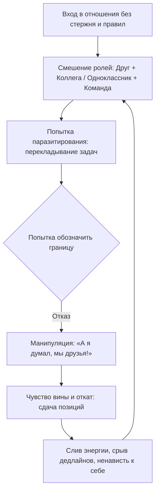

# 🧠 Конспект: 00. Аудит твоего окружения (Формируем запрос)

> *"Палец новый не отрастет. Представь, что к тебе подходит человек и говорит: «Отдай мне свой палец, он мне нужен». Даже если это будет безболезненно, ты же покрутишь у виска и пошлешь его? Так почему тогда ты с легкостью отдаешь свои невосполнимые часы, ментальную энергию и фокус внимания людям, которые паразитируют на тебе и утягивают на дно?"*  
> — **Максим Олегович Коваль**

---

## 🎯 Главная суть

Окружение человека — это не пассивный фон, а **мощнейшее гравитационное поле**, которое непрерывно формирует образ мыслей, гормональный фон, уровень притязаний и допустимую планку дисциплины. 

Невозможно выстроить высокую продуктивность, подготовку на 300 баллов ЕГЭ или масштабировать сложный инженерный проект, если в ближнем радиусе находятся социальные «черные дыры», высасывающие когнитивный ресурс.

**Аудит окружения** — это нулевой шаг перед выстраиванием любой социальной архитектуры. Прежде чем чинить отношения, необходимо честно признать:
1. Твое внимание и ментальный ресурс строго конечны (метафора *«пальца»*).
2. Любые отношения строятся на ролевых моделях и взаимных контрактах.
3. Без базового самоуважения и внутреннего стержня любые попытки выстраивать границы приводят либо к капитуляции перед манипуляторами, либо к полному растворению в чужой воле.

---

## ⚠️ Анатомия социальных утечек и коллизий



### 1. Метафора «Отрезанного пальца»: цена невосполнимого ресурса
- Человек инстинктивно защищает физическую целостность своего тела. Если кто-то попытается отнять палец, реакция будет бескомпромиссной.
- Однако ментальный ресурс, фокус внимания и время воспринимаются как нечто абстрактное и бесконечное. 
- Каждый раз, соглашаясь на бессмысленный пустой разговор, выслушивание многочасового нытья или выполнение чужих обязанностей «из вежливости», ты добровольно отрезаешь от себя кусок когнитивной дееспособности, который сегодня уже не восстановится.

### 2. Ядерные смеси: пересечение несовместимых ролей
Одна из главных причин крушения дружбы и проектов — смешение контекстов:
- **Друг + Коллега / Бизнес-партнер**: в дружбе базой является безусловная эмоциональная связь, а в работе — жесткая подотчетность, дисциплина и финансовый расчет.
- **Друг + Одноклассник за партой**: на уроке требуется предельная концентрация на материале, но дружеская роль диктует постоянные шутки, переглядки и отвлечения. В итоге школа превращается в слив времени.
- **Романтический партнер + Общий бизнес**: эмоциональные обиды переносят на операционные процессы компании, парализуя команду.

> [!WARNING] Ловушка «Бесплатной дружбы»
> Когда один участник регулярно просит профессиональной помощи или выполнения тяжелой рутины, прикрываясь дружбой:
> - Оплата труда или эквивалентный взаимообмен **не исключают** дружбу, а защищают ее от паразитизма.
> - Если на попытку выставить адекватные условия следует обвинение: *«А я думал, мы друзья, ты оказывается меркантильный!»* — перед тобой классическая токсичная манипуляция виной.

---

## 🛡️ Фундамент: Самоуважение против растворения

```
                     ┌───────────────────────────────────┐
                     │   ВНУТРЕННИЙ СТЕРЖЕНЬ (Самоуважение)│
                     │  - Понимание цены своих усилий   │
                     │  - Защита ЗНТ и образа будущего   │
                     └─────────────────┬─────────────────┘
                                       │
                      ┌────────────────┴────────────────┐
                      ▼                                 ▼
         [Здоровая автономия]              [Четкая калибровка границ]
         «Я иду к своей цели,              «Я готов слышать тебя,
          но уважаю твой выбор»             но не предам свои принципы»
```

### Две ловушки ментальной незрелости
Если человек с несформированной субъектностью входит в близкие отношения (дружеские или романтические), он гарантированно падает в одну из двух крайностей:
1. **Полное растворение в другом**: потеря собственных интересов, режима, ценностей и целей. Человек перенимает чужой образ жизни, становясь «придатком» чужой личности.
2. **Использование другого как затычки**: попытка закрыть чужим вниманием собственную внутреннюю пустоту, тревогу и нелюбовь к себе. Постоянное требование доказательств верности и одобрения.

### Синдром «Подросткового коллапса»
- Типичный сценарий: отношения длились 3–4 месяца. Случился разрыв.
- Подросток без стержня впадает в кататоническую депрессию: забрасывает учебу, срывает подготовку к экзаменам, теряет полгода жизни и проваливает поступление.
- **Позиция зрелости**: пережить боль и грусть — естественно и нормально. Но ставить на кон свое будущее, образование и многолетний труд из-за локального расставания — признак нулевого самоуважения к собственным прошлым и будущим усилиям.

---

## ⚡ Системные выводы

1. **Любовь к себе — это не нарциссизм**: это базовое инженерное уважение к своему телу (ЗНТ), своему времени и своему образу будущего. Не позволять ломать свой график и втягивать себя в саморазрушение.
2. **Отношения не должны быть черно-белыми**: существуют градации дистанции, уровней доступа и контекстов.
3. **Никакой жалости к манипуляторам виной**: фраза *«Ты изменился / стал холодным / зазвездился»* на самом деле переводится как: *«Мне стало неудобно тобой пользоваться»*.

---

## 🔗 Связанные материалы

- Практическое упражнение: [[Упражнение - Аудит ближнего круга (Энергетический баланс)]]
- Следующая лекция блока: [[Конспект - 01. Карта отношений (Кто рядом и как это влияет)]]
- Навигатор модуля: [[03_Knowledge/Мышление и Продуктивность/README|README — Мышление и Продуктивность]]
