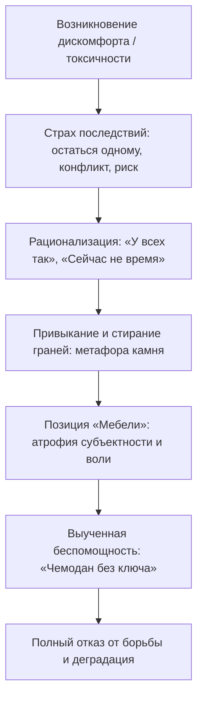

# 🧠 Конспект: 09. Почему ты терпишь то, что тебе не нравится

> *"Чем больше ты терпишь то, что тебя разрушает, тем больше превращаешься в обточенный морем камень: гладкий, серый, круглый, без острых граней, без своих хотелок и без своего образа будущего. Лежишь на пляже точно такой же, как миллионы других камней вокруг. Ты кто в этой жизни — неодушевленная мебель, которую двигают по комнате чужие руки, или активный герой своего пути? Подконтрольная нетерпимость — это главный маркер живого, осознанного человека."*  
> — **Максим Олегович Коваль**

---

## 🎯 Главная суть

Человеческая психика обладает колоссальной способностью к **адаптации**. Но эта способность является обоюдоострым мечом: точно так же, как человек адаптируется к росту нагрузок в спорте, он незаметно привыкает к токсичной среде, пренебрежению, собственной лени и жизни вполсилы.

Терпение часто подается культурой как высшая добродетель. В реальности существует **пропасть между двумя видами терпения**:
1. **Конструктивное терпение (Стратегический гамбит)**: временный отказ от сиюминутного комфорта ради достижения масштабной цели (тяжелый бот математики, ранние подъемы, строгий режим).
2. **Неконструктивное терпение (Эрозия личности)**: пассивное смирение с тем, что причиняет боль, унижает достоинство или ведет к деградации, в ситуациях, когда параметры среды можно и нужно изменить.

---

## ⚠️ Анатомия выученной адаптации

### 1. Метафора «Морского камня»
- Волна за волной прибой шлифует бесформенную каменную глыбу. Со временем острые сколы, индивидуальная текстура и грани исчезают. Камень становится идеальным окатышем.
- Человек, годами терпящий токсичных начальников, насмешки друзей или собственную нереализованность, точно так же теряет свои уникальные цели, ценности и амбиции. Он становится удобным для всех, но мертвым внутри.

### 2. Мебель vs Активный герой
- **Позиция «Мебели»**: неодушевленный шкаф или тумбочка не выбирают, где стоять. Их передвигают грузчики. Люди с психологией мебели меняют работу или окружение только тогда, когда их вышвырнут или доведут до крайности.
- **Позиция «Активного героя»**: субъект, заметивший отклонение от своих стандартов, немедленно запускает корректирующее действие. Он не ждет, пока «само рассосется».

### 3. Синдром «Чемодана с золотом без ключа»
Одна из главных причин апатии и нежелания менять жизнь — **убежденность в недостижимости цели**:
- Человек ясно видит красивую жизнь, высокие баллы, достаток, крепкие отношения (видит «золото»).
- Но он абсолютно уверен, что у него нет и никогда не будет «ключа» (связей, таланта, денег, здоровья).
- **Ошибка модели**: жизнь — это система с сотнями параметров (привычки, окружение, реакции, фокус, навыки). Сдвиг даже нескольких параметров на миллиметр создает **уникальную комбинацию действий**, которая практически гарантированно взламывает исходную задачу. Ключ не выдается при рождении — он вытачивается ежедневными действиями.

---

## 🧭 Матрица терпения: Гамбит vs Саморазрушение

| Параметр | Конструктивное терпение (Гамбит) | Неконструктивное терпение (Эрозия) |
| :--- | :--- | :--- |
| **Цель** | Четко определенный образ будущего (поступление, мускулатура, проект). | Отсутствует. Единственная цель — избежать конфликта и страха. |
| **Контроль** | Осознанное личное решение: «Я выбираю это терпеть сегодня ради завтра». | Вынужденная реакция жертвы: «А что я могу поделать?». |
| **Сроки** | Ограничено во времени (спринт до мая, испытательный срок). | Бессрочно, годами переходящее в образ жизни. |
| **Динамика личности** | Закалка характера, рост компетенций и самоуважения. | Выгорание, стыд, цинизм, потеря уважения к себе. |

---

## ⚡ Протокол «Подконтрольной нетерпимости»

1. **Нетерпимость к паразитизму**: если общение с человеком регулярно разрушает твое эмоциональное состояние — прекращай контакт или выставляй жесткий ультиматум.
2. **Нетерпимость к собственной слабости**: не принимай от себя дешевые оправдания («я устал», «сегодня погода плохая»). Твое тело обязано подчиняться твоему разуму.
3. **Холодный расчет вместо истерики**: нетерпимость — это не крики и драки, а твердое, спокойное внутреннее решение: *«Со мной так нельзя. Этот формат неприемлем»* с последующим бескомпромиссным действием.

---

## 🔗 Связанные материалы

- Практическое упражнение: [[Упражнение - Аудит зон неконструктивного терпения]]
- Карта отношений: [[Конспект - 01. Карта отношений (Кто рядом и как это влияет)]]
- Следующая лекция блока: [[Конспект - У тебя нет ничего, кроме денег]]
