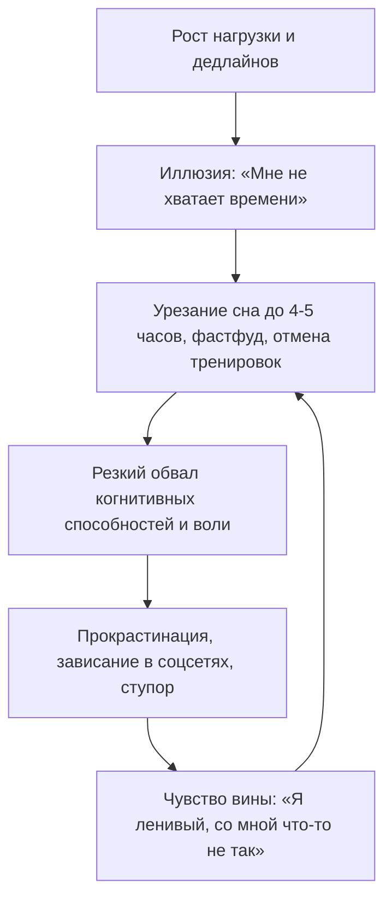

# 🧠 Конспект: Базовые настройки и образ мышления

> *"Если у тебя нет фундамента, любая надстройка просто рухнет. Нельзя построить небоскреб на болоте без свай."*  
> — **Максим Олегович Коваль**

---

## 🎯 Главная суть

Продуктивность, высокие академические результаты (100 баллов ЕГЭ, победы на олимпиадах, сильный код) и жизненная устойчивость — это **не следствие тайм-менеджмента, списков задач или силы воли**. Это производная от **двух базовых опор фундамента**:

1. **ЗНТ (Заводские настройки тела)**: биологическая база организма (сон, питание, циркуляция крови и движение, гормональный баланс).
2. **Образ мышления (Mindset)**: модель интерпретации реальности, субъектность (100% ответственность), умение работать со страхом и двигаться в условиях неопределенности.

Попытка внедрить тайм-менеджмент, жесткие трекеры и приоритизацию на невыспавшееся, истощенное тело с деструктивными установками — гарантированный путь к выгоранию, депрессивным эпизодам и когнитивному коллапсу.

---

## ⚠️ Анатомия проблемы (Почему 90% делают наоборот)

Когда наваливается лавина дедлайнов (экзамены, курсовые, работа), стандартная реакция большинства людей:



### Эксперимент МО в МГУ: ловушка сна через день
Максим Олегович на 1-м курсе механико-математического факультета МГУ поставил над собой эксперимент: ради мнимого выигрыша времени спал через день на протяжении месяца.
- **Ожидание**: удвоение времени на учебу и подготовку к сложнейшим экзаменам.
- **Реальность**: приходил на лекцию, садился на последнюю парту и часами смотрел в одну точку. Мозг перешел в режим выживания. Способность решать нестандартные задачи и удерживать абстрактные концепции упала до абсолютного нуля.
- **Вывод**: Время — это фиксированная плоскость. Увеличение количества часов за счет биологии дает отрицательную полезность.

### Ложный диагноз: «Лень»
Лень в 95% случаев — это **не дефект характера**, а системный аварийный клапан организма:
1. Либо у тела физически нет АТФ и нейромедиаторов для действия (сбито ЗНТ).
2. Либо мозг не видит безопасного, обозримого пути к цели и блокирует расход ресурса через страх.

---

## 🧠 Ключевые ментальные модели и законы

### 1. Архитектура: Фундамент vs Надстройки

```
        ▲  [ Тайм-менеджмент / GTD / Notion / Календари ]  <-- Надстройки
       / \ [ Продвинутые техники обучения / Спринты    ]
      /───\─────────────────────────────────────────────
     │     │  ЗНТ (Сон, Питание, Движение, Биохимия)   │  <-- ФУНДАМЕНТ
     │     │  Образ мышления (Субъектность, Смысл)     │
     └─────┴───────────────────────────────────────────┘
```

> **Метафора летней кухни**:  
> Строители поставили деревянную летнюю кухню прямо на голую землю без фундамента. Через два сезона доски сгнили от сырости, каркас перекосило, двери перестали открываться, а крышу сорвало ветром.  
> То же самое происходит со студентом, который ставит приложения-планеры, не наладив 8-часовой сон.

> **Метафора параметров (№18 профильной математики)**:  
> Нельзя научиться решать сложнейшие задачи с параметром, если ты не умеешь раскрывать модули, делать равносильные переходы и факторизовать многочлены. Любая надстройка требует безупречной базы.

---

### 2. Три ресурса: Полотно, Топливо и Вектор

| Ресурс | Статус | Природа | Возможность генерации |
| :--- | :--- | :--- | :--- |
| **Время** | Полотно | Фиксировано (24 часа) | Невозможно увеличить или накопить. |
| **Энергия** | Топливо | Биологический ресурс тела | Генерируется через сон, питание, спорт и восстановление. |
| **Внимание** | Вектор силы | Ограниченный когнитивный ресурс | Истощается при частых переключениях контекста и стрессе. |

---

### 3. Закон окрестности ближайшего шага (Метафора ночной трассы)

Представь, что ты едешь на автомобиле из Москвы в Сочи темной ночью:
- Ты не видишь Сочи из Москвы.
- Ты не видишь дорогу за поворотом через 200 километров.
- Твои фары освещают ровно **50 метров вперед**.
- Но если ты держишь руль и непрерывно проезжаешь эти 50 метров, ты неизбежно доедешь до Черного моря.

```
[Текущая точка] ──( 50 метров видимости )──> [Следующий шаг] ──> ... ──> [Финальная цель: Сочи / Иннополис]
```

**Ошибка**: открывать кодификатор или задачи олимпиады/ЕГЭ в сентябре и пытаться мысленно «проглотить» весь 9-месячный путь за один присест. Мозг видит пропасть и включает ступор.  
**Правило**: сфокусироваться на идеальном прохождении **окрестности ближайшего шага** (выбрать онлайн-курс, разобрать теорию по тригонометрии, решить 10 задач).

---

### 4. Инверсия ответственности (Ликвидация роли жертвы)

Перестань проецировать причины своих неудач на внешнюю среду:
- *«Родители не понимают»*
- *«В провинции нет возможностей»*
- *«Школа отнимает время»*
- *«Мир несправедлив»*

Пока ты обвиняешь внешние обстоятельства, ты добровольно отдаешь им пульт управления своей жизнью. Принятие 100% субъектности означает:  
> *«Мир таков, каков он есть. Гора равнодушна к альпинисту. Моя задача — трезво оценить свои карты и сделать лучший ход из возможных»*.

---

## ⚡ Системные выводы

1. **Биология первична**: сон 7.5–8.5 часов — это не награда за сделанные дела, а технологическая необходимость для очистки мозга глифатической системой и консолидации памяти.
2. **Лень — это сигнал датчика на приборной панели**: загорелась лампочка «Check Engine» — проверь сон, еду, уровень перегрузки и ясность цели, а не дави сильнее на педаль газа.
3. **Двигайся по фарам**: держи глобальное видение в голове, но оперативное внимание направляй только на следующие 50 метров пути.
4. **Субъектность**: никто не придет спасать твое будущее. Только ты определяешь качество своих выборов.

---

## 🔗 Связанные материалы

- Практический протокол аудита: [[Упражнение - Базовые настройки и образ мышления]]
- Следующий шаг модуля: [[Конспект - Пожиратели энергии и системный цикл ПДВ]]
