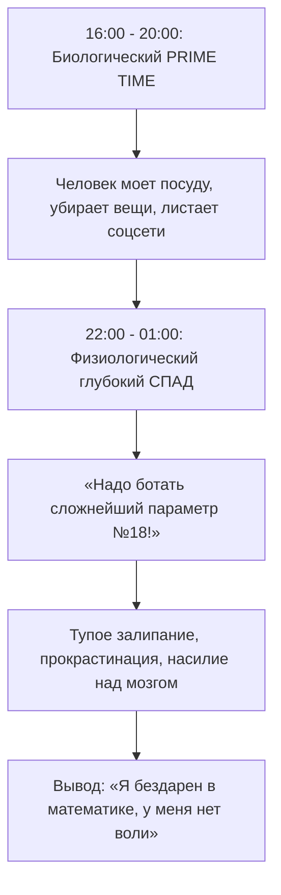

# ⚡ Конспект: Биологические пики и защита Prime Time

> *"Вдумайтесь, какая абсурдность: слить свои 3–4 лучших часа в сутках — свой биологический прайм-тайм, за который можно сдвинуть горы, — на листание ленты TikTok или мытье посуды! Время прайм-тайма священно. Защищай его жестко."*  
> — **Максим Олегович Коваль**

---

## 🎯 Главная суть

Каждый человек функционирует по индивидуальным циркадным биоритмам. В течение суток уровень энергии и ресурса внимания совершает закономерные колебания: есть часы **максимального подъема (Prime Time)** и часы **естественного физиологического спада**.

В часы спада насилие над собой дает мизерную отдачу и колоссальное утомление ЦНС. В часы Prime Time организм добровольно выдает запредельную концентрацию. Высшее мастерство продуктивности заключается в том, чтобы **согласовать самые сложные, судьбоносные задачи (профильная математика 2-я часть, олимпиадное программирование, архитектура проектов) строго с биологическим прайм-таймом**, а рутину сдвинуть в часы спада.

---

## ⚠️ Анатомия проблемы (Почему 90% делают наоборот)

Большинство людей живут в состоянии непрерывного преступления против собственной физиологии:



### Главные ошибки:
1. **Слив золотых часов на бытовой мусор**: когда мозг готов совершать научные открытия, человек решает наколоть дров, сходить в магазин или разобрать шкаф.
2. **Искажение картины стимуляторами**:
   - **Кофеин**: берет энергию взаймы у *сегодняшнего вечера* (после искусственного взлета неизбежен глубокий провал в этот же день).
   - **Алкоголь**: берет энергию взаймы у *следующего дня* (уничтожает архитектуру REM-фазы сна).
   - **Тяжелые углеводы / переедание**: кровь отливает к ЖКТ, мозг впадает в кому.

---

## 🧠 Ключевые ментальные модели и законы

### 1. Триада ресурсов (Углубленный анализ)

```
┌─────────────────────────────────────────────────────────────┐
│                      ВРЕМЯ (24 ЧАСА)                        │  <-- Неизменное полотно
├──────────────────────────────┬──────────────────────────────┤
│           ЭНЕРГИЯ            │           ВНИМАНИЕ           │  <-- Динамические ресурсы
│    (Топливо организма)       │    (Фокус префронтальной     │
│   Колеблется по синусоиде    │            коры)             │
└──────────────────────────────┴──────────────────────────────┘
```

- Подъемы и спады энергии и внимания происходят **синхронно**.
- Картина биоритмов стабильна во времени: сделав качественный замер один раз, ты получаешь карту продуктивности на месяцы вперед.

---

### 2. Принцип «Бункера» (Бескомпромиссная защита Prime Time)

Прайм-тайм длится от 2 до 4 часов в день. В это окно ты обязан создать режим абсолютной изоляции:

| Фактор | Стандартное поведение (Слив) | Режим «Бункер» (МО) |
| :--- | :--- | :--- |
| **Связь** | Телефон лежит рядом, включены пуши | Авиарежим / Телефон в другой комнате |
| **Локация** | Шумная комната с отвлекающими | Библиотека, изолированный кабинет, парк |
| **Доступность** | «Отвечаю всем за 2 минуты» | Нулевая доступность для звонков и чатов |
| **Тип задач** | Смесь рутины, почты и учебы | Строго одна ключевая задача уровня Hard |

---

### 3. Гибкая адаптация расписания

Расписание не должно быть тюрьмой с жестко забетонированными часами на 5 лет вперед:
- В разные дни недели биоритмы могут слегка сдвигаться (например: вторник/среда пик в 16:00–20:00, суббота — в 10:00–14:00).
- **Дай организму право выбора**: если ты видишь, что прямо сейчас наступил внезапный подъем сил, не трать его на механическую домашку — мгновенно переключайся на самую приоритетную задачу стратегического уровня.

---

## ⚡ Системные выводы

1. **Замерь свои пики**: не строй гипотез — проведи беспристрастный 7-дневный эксперимент без стимуляторов.
2. **Защищай Prime Time как зеницу ока**: ни один звонок, уведомление или бытовой вопрос не имеют права вторгаться в часы пиковой отдачи.
3. **Легализуй часы спада**: спад энергии — не преступление, а физиологическая потребность. Отведи эти часы под легкую прогулку, быт, оформление конспектов или сон.
4. **Убери допинги перед замером**: кофе и сахар маскируют реальные сигналы тела, мешая увидеть истинный профиль твоей энергосистемы.

---

## 🔗 Связанные материалы

- Практический трекер пиков: [[Упражнение - Биологические пики и защита Prime Time]]
- Дофаминовый цикл: [[Конспект - Практический цикл ПДВ и чистый дофамин]]
- Базовый фундамент: [[Конспект - Базовые настройки и образ мышления]]
