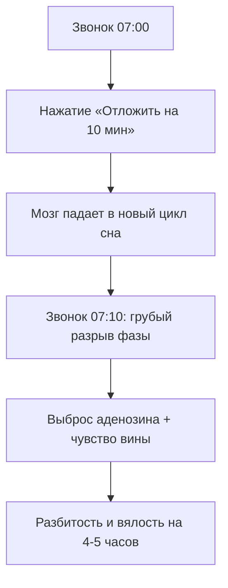

# ⏰ Конспект: Будильник — Встать, нельзя сдаваться

> *"ВСТАТЬ! Нельзя сдаваться! Только ты можешь справиться с этой задачей. Только ты сможешь это сделать. Никто другой за тебя не сделает. Только ты! Я в тебя верю, у меня есть надежда только на тебя!"*  
> — **Максим Олегович Коваль**

---

## 🎯 Главная суть

Утренний будильник — это не просто звук таймера, это **первая и самая главная стратегическая битва твоего дня**. В первые 5 секунд после пробуждения определяется психоэмоциональный статус следующих 16 часов:

- Либо ты принимаешь роль **Автора (Субъекта)**, мгновенно вертикализируешь тело и берешь ответственность за свою судьбу.
- Либо ты нажимаешь кнопку «Отложить» (Snooze), совершаешь первое мелкое предательство себя и скатываешься в роль пассивной жертвы обстоятельств.

Никто за тебя не выучит математику, никто за тебя не поступит в университет мечты, никто за тебя не построит тело атлета и не напишет код. Только ты.

---

## ⚠️ Анатомия проблемы (Почему 90% делают наоборот)

### 1. Катастрофа кнопки «Отложить» (Snooze / Фрагментация сна)
90% людей совершают грубейшую физиологическую ошибку: ставят 5 будильников с интервалом в 10 минут (*07:00, 07:10, 07:20, 07:30*).
- **Биологическая реальность**: при повторном засыпании мозг запускает новый глубокий цикл сна. Звонок через 10 минут выдергивает человека из середины цикла.
- **Итог**: возникает тяжелая **патологическая инерция сна (Sleep Inertia)**. Человек встает разбитым, с головной болью и «ватой в голове», которая держится до самого обеда. Никакой бодрости эти 30 минут дремоты не добавляют — они лишь отравляют утро.

### 2. Психологический слом воли
Первое решение дня задает шаблон для всех последующих выборов:
- Нажал «Отложить» ➔ показал своему мозгу, что твои цели и планы не имеют реальной силы.
- Встал мгновенно ➔ зафиксировал статус дисциплинированного хищника, готового рвать задачи.

---

## 🧠 Ключевые ментальные модели и законы

### 1. Закон вертикализации и Правило 5 секунд

> **Физиологический закон**: Пока тело горизонтально, лимбическая система генерирует тысячи правдоподобных отговорок (*«сегодня пасмурно», «я мало спал», «от одной пропущенной задачи ничего не будет»*).

Как только стопы коснулись пола и позвоночник выпрямился, вестибулярный аппарат и барорецепторы посылают сигнал в ретикулярную формацию ствола мозга: **«Тело на ногах, включай сознание!»**.

$$5 \longrightarrow 4 \longrightarrow 3 \longrightarrow 2 \longrightarrow 1 \longrightarrow \mathbf{ВСТАТЬ!}$$

Не вступай в диалог с сонным мозгом. У тебя есть ровно **5 секунд**, чтобы оторвать спину от матраса до того, как включится логика лени.

---

### 2. Протокол ликвидации аденозинового тормоза

Чтобы мгновенно разогнать туман инерции сна:
1. **Топологическая изоляция будильника**: будильник должен лежать минимум в 3 метрах от кровати. Чтобы его выключить, ты обязан встать на ноги и сделать 5 шагов.
2. **Гидравлический удар**: 500 мл прохладной чистой воды залпом восстанавливают объем циркулирующей крови и будят ЖКТ.
3. **Холодная вода на лицо (Окулокардиальный рефлекс)**: всплеск холодной воды в глаза резко повышает симпатический тонус и сужает сосуды.
4. **Свет**: немедленно открыть жалюзи или включить яркий верхний свет.

---

### 3. Радикальная субъектность («Только ты!»)

Мантра Максима Олеговича — это абсолютная антидотная прививка от инфантилизма:
- Никто не придет и не сделает тяжелую работу за тебя.
- Все оправдания бессмысленны: миру все равно, почему ты не справился.
- У тебя есть единственный реальный ресурс — твоя собственная воля и твои сегодняшние действия.

---

## ⚡ Системные выводы

1. **Один будильник — один подъем**: кнопка Snooze объявляется вне закона. Либо ты встаешь в 07:00, либо честно ставишь будильник на 07:30 и спишь непрерывным сном.
2. **Вставай на автопилоте**: не думай о смысле жизни в кровати. Сначала ноги на пол, стакан воды, умывание — и только потом анализ планов.
3. **Держи слово перед собой**: утренний подъем по первому сигналу — фундамент самоуважения и несгибаемой уверенности в себе.
4. **Помни свою цель**: ты встаешь не для того, чтобы терпеть рутину, а чтобы забрать свое будущее.

---

## 🔗 Связанные материалы

- Практический трекер подъема: [[Упражнение - Будильник — Встать, нельзя сдаваться]]
- Циркадный кортизол: [[Конспект - Кортизол — друг или враг человека]]
- Базовый фундамент ЗНТ: [[Конспект - Базовые настройки и образ мышления]]
