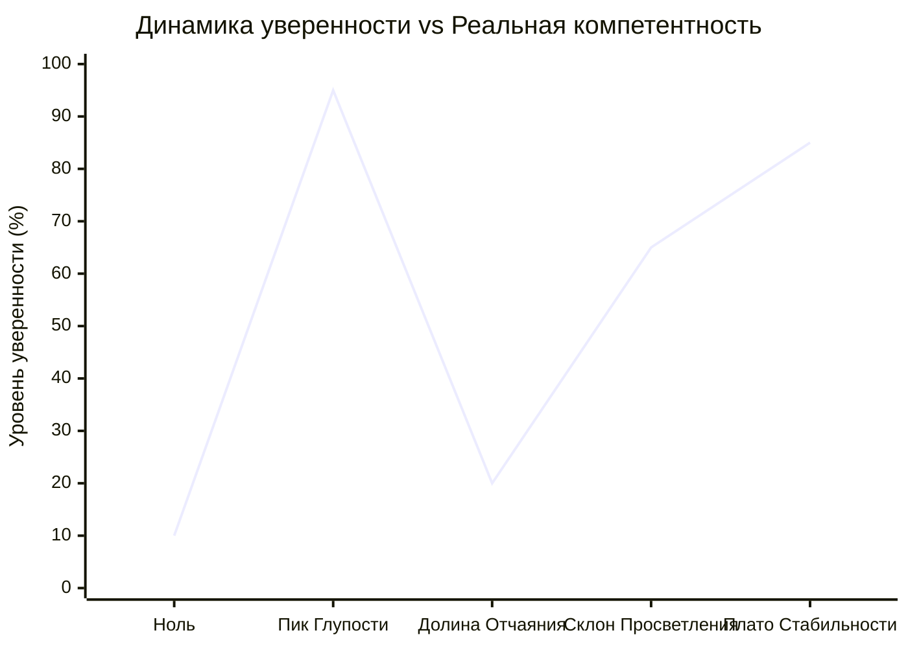

# 👑 Голый король // Контра-Даннинг-Крюгер

> **«Чтобы понять уровень своей некомпетентности, уже требуется высокий уровень компетентности. Трагедия дилетанта в том, что он даже не способен осознать, насколько он слеп.»**  
> — *Максим Олегович Коваль*

---

## ⚡ 01 // Главная суть (TL;DR)

Эффект Даннинга-Крюгера описывает искажение самовосприятия, при котором люди с минимальным багажом знаний в определенной сфере делают ошибочные выводы, принимают катастрофические решения и при этом преисполнены абсолютной уверенности в своем превосходстве.

Парадокс заключается в том, что **инструмент оценки компетенции и есть сама компетенция**. Если у человека нет фундаментальных знаний математической логики, он не способен увидеть пробелы в собственном решении задачи.

Упражнение **«Голый король»** — это практический протокол отрезвления. Оно позволяет оперативно диагностировать свое текущее положение на кривой мастерства, сбить опасную спесь на *Пике Глупости* и вытащить себя из паралича в *Долине Отчаяния*.

---

## 🧮 02 // Динамическая фазовая модель (Кривая Даннинга-Крюгера)



### 4 фазы эволюции разума:

1. **Фаза I: Пик Глупости (Mount Stupid)**
   - *Формула состояния:* $\text{Компетентность} \to 0, \quad \text{Уверенность} \to 100\%$.
   - Человек прочитал пару популярных статей, посмотрел несколько коротких видео или прошел двухнедельный вводный курс. Мозг не видит границ предметной области и считает, что постиг абсолютную истину.
   - *Главная опасность:* Принятие необратимых рискованных решений (открытие стартапа без анализа рынка, агрессивная езда после 1 месяца за рулем, отказ от базовой подготовки к ЕГЭ с убеждением «я и так на сотку сдам»).

2. **Фаза II: Долина Отчаяния (Valley of Despair)**
   - *Формула состояния:* $\text{Компетентность} > 0, \quad \text{Уверенность} \to 0$.
   - При углублении в дисциплину вскрывается истинный масштаб айсберга. Индивид понимает, сколько сотен нюансов, исключений и скрытых сложностей он не знает. Острая вспышка синдрома самозванца.
   - *Главная опасность:* Капитуляция, опускание рук и бросание дела за шаг до формирования устойчивого навыка.

3. **Фаза III: Склон Просветления (Slope of Enlightenment)**
   - Методичное освоение фундаментальных принципов через практику, решение сотен трудных задач, получение обратной связи от среды. Уверенность начинает расти строго пропорционально твердому навыку.

4. **Фаза IV: Плато Стабильности (Plateau of Sustainability)**
   - Зрелый эксперт. Спокойное, сдержанное осознание своих сильных сторон и четкое понимание границ применимости своих знаний.

---

## 🏛️ 03 // Пять столпов верификации (Фильтр «Голый король»)

Чтобы объективно установить, не является ли ваша уверенность иллюзией «голого короля», Максим Олегович вводит жесткий 5-факторный чек:

```
                  ┌────────────────────────────────────────┐
                  │       ФИЛЬТР «ГОЛЫЙ КОРОЛЬ»           │
                  └──────────────────┬─────────────────────┘
                                     │
         ┌──────────────┬────────────┴─────────────┬──────────────┐
         ▼              ▼                          ▼              ▼
   1. ДИСТАНЦИЯ   2. ИЗМЕРИМЫЙ              3. ВНЕШНЕЕ      4. ГРАНИЦЫ
     ВРЕМЕНИ       РЕЗУЛЬТАТ                ПРИЗНАНИЕ       КОНТЕКСТА
   (Стаж > 6-12     (Слепой                 (Ревью от        (Где навык
     месяцев)       хард-тест)              экспертов)       НЕ работает)
```

1. **Дистанция времени и непрерывность погружения**: Сколько сотен часов чистого времени инвестировано в эту конкретную тему? Если меньше 300–500 часов — претензии на экспертность беспочвенны.
2. **Твердый измеримый результат**: Есть ли физические доказательства мастерства? Не ощущения («мне кажется, я понял»), а сданные официальные экзамены, победы в олимпиадах, работающий в проде код.
3. **Независимое внешнее признание**: Что говорят признанные мастера и авторитеты в этой сфере? Получена ли строгая обратная связь без поблажек?
4. **Осознание границ контекста**: Способен ли человек четко очертить рамки своей компетентности? 
   > *Пример МО Коваля:* «Я являюсь признанным экспертом в образовательном бизнесе и преподавании математики. Но я абсолютно некомпетентен в ремонте автомобилей или медицине. Переносить уверенность из одной сферы в другую — верный путь к катастрофе».
5. **Сверка с авторитетной базой знаний**: Проверка своих представлений по академическим учебникам, критериям ФИПИ, исходному коду библиотек или документации.

---

## 🕳️ 04 // Когнитивные слепые зоны и психологические ловушки

| Ловушка | Психологический механизм | Разрушительные последствия |
| :--- | :--- | :--- |
| **Галлюцинация гениальности** | Эвристика легкости: «Если решение пришло мне в голову за 2 секунды, значит, я гений». | Игнорирование граничных условий, потеря баллов на банальных математических ловушках. |
| **Проекция локального успеха** | «Я чемпион школы по олимпиадам 8-го класса, значит, 2-я часть профиля для меня семечки». | Смертельный нокаут на первом же реальном авторском пробнике Школково. |
| **Паралич долины отчаяния** | «Я ничего не знаю, вокруг гении, мне никогда не освоить стереометрию». | Блокировка действий, уход в апатию вместо понимания, что кризис — признак реального роста. |

---

## 🛡️ 05 // Системные правила работы с кривой Даннинга-Крюгера

1. **Если ты на Пике Глупости**: Запрети себе принимать радикальные необратимые решения (бросать вуз, менять стратегию подготовки, инвестировать последние деньги). Твоя единственная задача — найти задачу, которая тебя сломает, и сбить спесь.
2. **Если ты в Долине Отчаяния**: Пойми физиологию процесса. Твоя неуверенность — это признак того, что твой кругозор расширился быстрее, чем текущие технические навыки. Зафиксируй пройденную дистанцию и продолжай методичную рутину.
3. **Король никогда не должен быть голым**: Настоящая уверенность держится не на вере в себя, а на тысячах решенных задач и проверенном стрессоустойчивом алгоритме.

---

## 🔗 Связанные материалы

- Практический протокол: [[Упражнение - Калибровка реальной компетенции]]
- Триумвират ловушек: [[Конспект - Закон Гудхарта, Ошибка выжившего и Даннинг-Крюгер]]
- Работа с вероятностями: [[Конспект - Мультивселенная исходов (Контра ошибки выжившего)]]
- Карта модуля: [[03_Knowledge/Мышление и Продуктивность/README|База Знаний: Мышление, Энергия и Осознанность]]
