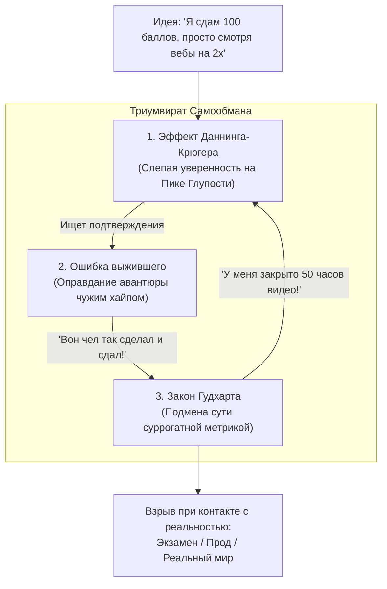

# ☣️ Когнитивный Триумвират // Гудхарт, Ошибка выжившего, Даннинг-Крюгер

> **«Даннинг-Крюгер дарит слепую уверенность, Ошибка выжившего находит красивое оправдание в чужом успехе, а Закон Гудхарта рисует фиктивные победы в отчетах. Вместе они образуют идеальную систему самоуничтожения личности.»**  
> — *Максим Олегович Коваль*

---

## ⚡ 01 // Главная суть (TL;DR)

В одиночку каждое когнитивное искажение наносит локальный вред. Но когда три фундаментальные ментальные ловушки соединяются в единую связку, они формируют **замкнутую петлю психологического бреда**:

1. **Эффект Даннинга-Крюгера** парализует способность критически оценивать свой уровень: новичок с минимальными знаниями взлетает на *Пик Глупости*, искренне считая себя экспертом.
2. **Ошибка выжившего** услужливо подбирает в инфополе единичный пример крайнего выброса (человека, совершившего глупейшее действие с отрицательным мат. ожиданием, но сорвавшего куш за счет слепой дисперсии) и объявляет его доказательством правоты.
3. **Закон Гудхарта** услужливо подсовывает суррогатную метрику (просмотры, лайки, часы за столом, купленные курсы), которая легко растет и создает усыпляющую иллюзию победного шествия.

Человек живет в состоянии абсолютной эйфории вплоть до момента столкновения с беспристрастной реальностью — жестким бланком ЕГЭ, продакшен-багом или банкротством.

---

## 🧮 02 // Синергетическая модель катастрофы

### Архитектура порочного круга


### Математическая природа искажения вероятностей
Пусть $P(\text{успех} \mid \text{стратегия } S)$ — истинная апостериорная вероятность успеха.
В нормальном байесовском анализе:
$$P(S \mid \text{Данные}) = \frac{P(\text{Данные} \mid S) P(S)}{P(\text{Данные})}$$

Когнитивный триумвират разрушает расчет вероятностей по трем осям:
1. **Даннинг-Крюгер** искусственно завышает априорную уверенность $P(S) \to 1$, игнорируя сложность предметной области.
2. **Ошибка выжившего** фильтрует выборку $P(\text{Данные})$, вычеркивая всё кладбище провалов и оставляя только один числитель $P(\text{Успех} \cap S)$.
3. **Закон Гудхарта** генерирует ложные валидирующие сигналы: метрика $M(t)$ растет, сообщая мозгу, что $P(S)$ подтверждается экспериментом.

В результате агент делает ставку с катастрофически отрицательным математическим ожиданием ($EV \ll 0$), будучи на 100% уверенным в триумфе.

---

## 🔬 03 // Клинический разбор кейса: БАДы, Здоровье и Учеба

Максим Олегович на лекции приводит предельно показательный пример с темой биохакинга, БАДов и препаратов для «разгона мозга»:

| Фаза | Мышление жертвы триумвирата | Реальный системный процесс |
| :--- | :--- | :--- |
| **1. Даннинг-Крюгер** | Человек посмотрел пару коротких рилсов или прочел статью на сомнительном ресурсе и решил, что разбирается в биохимии гормонов, нейромедиаторах и эндокринологии. | Полное отсутствие медицинского базиса, непонимание каскадных реакций ГГН-оси и метаболизма печени. |
| **2. Ошибка выжившего** | «Вон тот фитнес-блогер жрет 20 банок добавок в день и выглядит как Аполлон, значит, это работает!». | Игнорирование генетического бэкграунда блогера, фармподдержки за кадром и сотен людей, угробивших почки и ЖКТ аналогичными курсами. |
| **3. Закон Гудхарта** | Индивид начинает мерить свой «прогресс» количеством выпитых таблеток в день и потраченными деньгами на iHerb. | Метрика накручивается, организм зашлаковывается токсинами, ЦНС идет вразнос, но в трекере стоят победные галочки. |

Аналогичный паттерн проявляется в подготовке к олимпиадам и ЕГЭ:
1. *Даннинг-Крюгер*: «Математика простая, я в 9-м классе ОГЭ на 5 сдал, за 2 месяца всё заботаю».
2. *Ошибка выжившего*: «Брат друга моей знакомой за месяц до ЕГЭ начал ботать и поступил в МФТИ».
3. *Закон Гудхарта*: «Я прорешал 10 вариантов на РешуЕГЭ» (с подглядыванием в пояснения).
4. *Финал*: 62 балла на реальном экзамене.

---

## 🕳️ 04 // Системные когнитивные слепые зоны

1. **Симптом «Незнание о незнании»**: Низкоквалифицированный агент не имеет сенсоров для детекции собственной ошибки. Чтобы заметить дыру в математическом доказательстве, нужно знать строгую логику, которой у него нет.
2. **Абсолютизация положительных исходов**: Мозг биологически запрограммирован реагировать на яркие вспышки (победители лотереи, миллиардеры без диплома), игнорируя серую массу неудач.
3. **Конформизм перед простой метрикой**: Мозг охотно соглашается на обман («ну я же сидел за книгой»), чтобы избежать мучительного признания: *«Я сегодня ничему не научился»*.

---

## 🛡️ 05 // Инженерные принципы защиты

```
[ПРИНЦИП ТРОЙНОЙ ИЗОЛЯЦИИ]
Перед любой стратегической ставкой:
1. Сбей самоуверенность независимым тестом с эталоном.
2. Найди и изучи истории тех, кто следовал этой стратегии и погиб.
3. Проверь метрику: можно ли ее накрутить, будучи полным бездарем?
```

- **Антидот к Даннингу-Крюгеру**: [[Конспект - Голый король (Контра Даннинга-Крюгера)]] (проверка по авторитетной внешней базе знаний).
- **Антидот к Ошибке выжившего**: [[Конспект - Мультивселенная исходов (Контра ошибки выжившего)]] (реконструкция полного контекста и кладбища альтернатив).
- **Антидот к Закону Гудхарта**: [[Конспект - Метрика здравого смысла (МЗС)]] (векторные сбалансированные метрики).

---

## 🔗 Связанные материалы

- Практический скрининг: [[Упражнение - Комплексный фильтр когнитивных слепых зон]]
- Частные инструменты:
  - [[Конспект - Закон Гудхарта]]
  - [[Конспект - Голый король (Контра Даннинга-Крюгера)]]
  - [[Конспект - Мультивселенная исходов (Контра ошибки выжившего)]]
- Карта модуля: [[03_Knowledge/Мышление и Продуктивность/README|База Знаний: Мышление, Энергия и Осознанность]]
