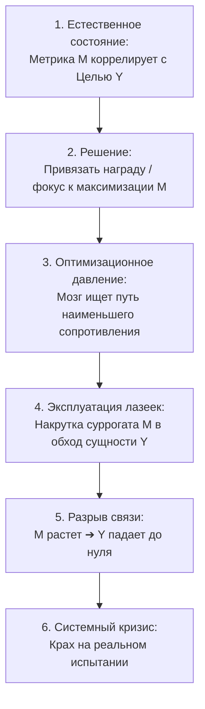

# 🎯 Закон Гудхарта // Анатомия деградации метрик

> **«Когда показатель становится целью, он перестает быть хорошим показателем.»**  
> — *Чарльз Гудхарт (1975) / Интерпретация Максима Олеговича Коваля*

---

## ⚡ 01 // Главная суть (TL;DR)

Любая метрика полезна лишь до тех пор, пока за ней **не** следят манипулятивно. Как только человек, команда или алгоритм начинает оптимизировать конкретное числовое значение показателя, поведение системы необратимо перестраивается: **мозг выбирает кратчайший путь к увеличению цифры, отбрасывая реальный смысл, ради которого эта метрика вводилась**.

В образовании это приводит к тому, что школьник учится «сдавать тесты методом исключения», не понимая физической сути формул. В кол-центре операторы сбрасывают звонки через 10 секунд, чтобы снизить показатель «среднее время разговора». В спорте атлет ломает суставы ради веса на штанге с кривой техникой.

Закон Гудхарта — это не частная ошибка менеджмента, а **фундаментальный закон человеческой психики и теории систем**: локальная оптимизация одномерного суррогата разрушает глобальную целевую функцию.

---

## 🧮 02 // Математическая и системная модель деградации метрик

### 1. Теорема об исчезновении корреляции
Пусть $Y$ — истинная ненаблюдаемая целевая переменная (например, *глубокий интеллект* или *качество клиентского сервиса*).  
Пусть $M$ — легко измеримый показатель-прокси (например, *количество решенных задач* или *длительность телефонного звонка*).

В естественных условиях (до введения административного давления):
$$\text{Corr}(M, Y) \approx \rho_0 > 0.8$$

Как только вводится правило награды или жесткого фокуса: $\max_{\vec{u}} M(\vec{u})$, пространство действий агента сужается до множества векторов $\vec{u}$, манипулирующих $M$:

$$\lim_{\text{давление} \to \max} \text{Corr}(M, Y) \le 0$$

Метрика полностью теряет свою информативность, превращаясь в источник шума и деградации системы.



### 2. Закон Кэмпбелла и Эффект Кобры как предельные формы Гудхарта
- **Закон Кэмпбелла (1976)**: «Чем сильнее количественный социальный показатель используется для принятия решений, тем большему искажению он подвержен и тем сильнее он коррумпирует процессы, для измерения которых предназначался».
- **Эффект Кобры**: Когда британские колониальные власти в Дели назначили награду за уничтоженных кобр, население начало массово разводить кобр на фермах. После отмены выплат змей выпустили, и популяция ядовитых рептилий в городе выросла кратно.

---

## 🏛️ 03 // Анатомия взлома: фундаментальные кейсы из практики

### Кейс 1: Кол-центр и KPI длительности звонка
- **Метрика:** Руководство обещало премию операторам за минимизацию показателя *«среднее время обработки вызова»* (AHT).
- **Взлом:** Операторы начали снимать трубку и немедленно сбрасывать звонок, либо давать формальные бессмысленные ответы и просить перезвонить.
- **Итог:** Среднее время звонка упало до рекордных 15 секунд (KPI перевыполнен на 200%), но удовлетворенность клиентов рухнула до критического уровня, компания потеряла миллионы.

### Кейс 2: Подготовка к ЕГЭ на 100 баллов
- **Метрика:** «Заниматься профильной математикой по 8 часов в сутки».
- **Взлом:** Мозг физически не способен поддерживать лазерный фокус 8 часов подряд без выгорания. Человек открывает конспект, включает стрим, но параллельно скроллит ленту, уходит в прокрастинацию и считает «время отсидки».
- **Итог:** 56 часов в неделю формально закрыто, но объем решенных трудных задач равен нулю. На реальном пробнике — шок и провал.

### Кейс 3: Замер эффективности образовательного продукта
- **Ловушка:** Максим Олегович подчеркивает: если бы он оценивал качество флагманского курса «Школково» исключительно по количеству восторженных комментариев под последним роликом на YouTube, он бы нанял спамеров или заставлял кураторов выбивать отзывы.
- **Анти-Гудхарт решение:** Использование многомерного тензора: процент поступления на бюджет, независимые победы на Всеросе, динамика активной аудитории платформы, признание государственными премиями, сменяемость когорт.

---

## 🕳️ 04 // Когнитивные слепые зоны: почему мозг влюбляется в суррогаты

1. **Эвристика доступности и легкости замера**: Нам гораздо легче посчитать страницы, часы или шаги, чем измерить уровень глубокого концептуального понимания стереометрии или архитектуры микросервисов.
2. **Дофаминовая зависимость от счетчиков**: Видеть, как число задач на счетчике увеличивается с 10 до 50, дает мгновенный дешевый дофаминовый всплеск, даже если все 50 задач были тривиальными уравнениями 5-го класса.
3. **Страх столкновения с реальным срезом**: Измерение реального навыка (написание слепого жесткого пробника) грозит нарциссической травмой («я готовился 3 месяца, а набрал всего 68 баллов»). Подмена метрики часами защищает эго от болезненной правды.

---

## 🛡️ 05 // Системные контрмеры: как обезвредить Закон Гудхарта

```
[ПРАВИЛО ПАРНЫХ МЕТРИК]
Ни одна метрика объема (скорость, количество, время) 
не имеет права существовать без парной метрики качества (точность, сложность, чистота).
```

1. **Метрика объема $\times$ Метрика качества**:
   - Не просто «решил 20 задач», а «решил 20 задач уровня сложности $\ge$ ЕГЭ-2024 с первой попытки без подсказок».
2. **Черный лебедь для системы (Случайный стресс-тест)**:
   - Регулярная проверка на случайной выборке задач из незнакомых источников (сборники других авторов, олимпиадные перечневые задачи), чтобы исключить привыкание к стилю одного составителя.
3. **Принцип «Метрика — это термометр, а не педаль газа»**:
   - Метрики должны использоваться для диагностики состояния, а не для прямого давления на систему. Если температура тела 38°C, глупо класть градусник в морозилку.

---

## 🔗 Связанные материалы

- Практическое упражнение: [[Упражнение - Аудит искажения метрик]]
- Инструмент решения проблемы: [[Конспект - Метрика здравого смысла (МЗС)]]
- Триумвират ловушек: [[Конспект - Закон Гудхарта, Ошибка выжившего и Даннинг-Крюгер]]
- Навигация по модулю: [[03_Knowledge/Мышление и Продуктивность/README|База Знаний: Мышление, Энергия и Осознанность]]
