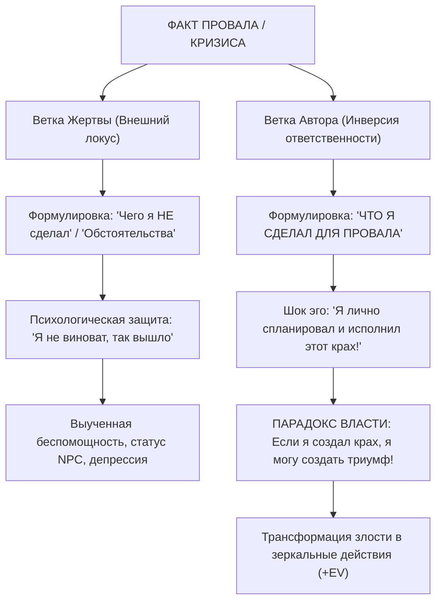

# 🔄 Инверсия ответственности // Возврат авторской позиции

> **«Перестань быть NPC в собственной жизни. Формулировка „я чего-то не сделал“ оставляет тебя пассивной мебелью. Скажи честно: „Я сделал всё возможное, чтобы провалиться“. Присвой себе авторство катастрофы — и ты получишь абсолютную власть всё исправить.»**  
> — *Максим Олегович Коваль*

---

## ⚡ 01 // Главная суть (TL;DR)

Большинство людей живут в режиме **внешнего локуса контроля (NPC-режим)**. Сталкиваясь с неудачей (заваленный экзамен, сорванный дедлайн, заплывшее тело), они используют усыпляющие формулировки пассивного залога: *«так сложились обстоятельства»*, *«мне не хватило времени»*, *«препод завалил»* или мягкое *«я просто чего-то не сделал»*.

Психика человека устроена так, что пассивное опущение («я не почитал конспект») воспринимается мозгом как простительная случайность. В результате человек раз за разом наступает на одни и те же грабли, чувствуя себя бессильной жертвой судьбы.

**Инверсия ответственности** — это жесткий психологический прием смены знака атрибуции. Мы принудительно переформулируем пассивный провал в **активную диверсию против самого себя**:
> *«Что я ЛИЧНО сделал, чтобы гарантированно провалить эту задачу?»*  
> *«Я сделал всё необходимое, чтобы остаться на обочине.»*

Возникающее при этом острое чувство злости и презрения к своей инфантильности трансформируется в термоядерное топливо для мгновенного выполнения противоположных действий.

---

## 🧮 02 // Психологическая и системная модель локуса контроля

### Сравнительная матрица атрибуции



### 1. Семантическая ловушка «Я не сделал»
Когда человек говорит: *«Я не ходил на пары, не решал ДЗ, не повторил формулы»*, подсознание считывает это как нейтральное отсутствие действия. Никакого греха нет — просто пустота. Человек продолжает считать себя умным и достойным, просто «немного отвлекшимся».

### 2. Психологический удар «Я сделал всё, чтобы проиграть»
Но когда человек формулирует:
- *«Я осознанно сидел в телефоне до 3 ночи перед важным утром»*,
- *«Я намеренно закрывал глаза на пробелы в параметрах №18»*,
- *«Я умышленно выбирал легкие задачи вместо сложных»*,  
мозг сталкивается с чудовищной правдой: **он выступил в роли профессионального диверсанта против своего же будущего**. Возникает сильный когнитивный диссонанс, разрушающий инфантильную зону комфорта.

### 3. Фундаментальный парадокс власти
> **Если причиной катастрофы были внешние силы (погода, государство, преподаватель) — ты раб, у тебя нет власти ничего изменить.**  
> **Но если автором катастрофы являешься ТЫ — значит, именно в твоих руках сосредоточен 100% контроль над ситуацией!**

Присваивая себе авторство поражения, ты автоматически присваиваешь себе власть над победой.

---

## 🔬 03 // Клинический разбор: Кейс студента / абитуриента

Максим Олегович на лекции препарирует классический диалог человека, завалившего сессию или важный срез:

| Стандартное мышление (Жертва / NPC) | Мышление Инверсии (Осознанный автор) |
| :--- | :--- |
| «Билет попался ужасный, препод валил, времени на подготовку в семестре вообще не было». | «Я лично сделал всё, чтобы вылететь: пропускал семинары, ни разу не подошел к преподавателю, в ночь перед экзаменом пил пиво в общаге». |
| «Ну я не прочитал методичку, с кем не бывает». | «Я хладнокровно саботировал свою учебу, потому что мне было лень преодолевать минимальный дискомфорт». |
| **Эмоция:** Обида на мир, жалость к себе, зависть к сдавшему одногруппнику. | **Эмоция:** Холодная ярость на свою глупость, отвращение к слабости. |
| **Действие:** Запой, слезы, поиск виноватых, апелляция. | **Действие:** Трансформация злости: немедленно взять лекции, расписать план пересдачи, сесть за конспект прямо сейчас. |

---

## 🕳️ 04 // Когнитивные слепые зоны и скрытые вторичные выгоды

Почему мозг так яростно сопротивляется инверсии ответственности?

1. **Вторичная выгода статуса «Жертвы»**:
   - Жертву все жалеют, к ней снисходительны, с нее снята ответственность за высокий результат. «У него же сложная ситуация в Шадринске/в семье». Признать себя автором — значит добровольно лишиться этой инфантильной соски.
2. **Нарциссическая защита от вины**:
   - Незрелое эго боится разрушиться от признания собственной ошибки. Инверсия ответственности учит не заниматься самоедством, а смотреть на свои действия как инженер на сбои в кодовой базе.
3. **Иллюзия занятости**:
   - Человек оправдывает провал тем, что «делал кучу других дел». Инверсия обнажает правду: эти дела были просто социально одобряемой прокрастинацией.

---

## 🛡️ 05 // Системные правила трансформации ярости

```
[ПРИНЦИП ТОПЛИВНОГО ЗЕРКАЛА]
1. Составь список диверсионных действий, которыми ты привел себя к краху.
2. Почувствуй честную злость на свое малодушие.
3. Разверни каждый пункт списка на 180 градусов.
4. Начни первое противоположное действие в течение 60 секунд.
```

1. **Ни секунды на самобичевание**: Инверсия нужна не для того, чтобы плакать в подушку. Она нужна, чтобы пробудить спортивную злость альпиниста.
2. **Зеркальный протокол**: Каждому разрушительному действию должно соответствовать прямое созидательное анти-действие.
3. **Принцип абсолютного суверенитета**: В твоей жизни нет непреодолимых внешних сил. Есть только твои реакции, твои ставки и твои физические решения.

---

## 🔗 Связанные материалы

- Практический протокол: [[Упражнение - Возврат локуса контроля]]
- Экстренный перехват: [[Конспект - Возглавь безумие]]
- Работа со страхом: [[Конспект - Как победить страх (Создай мультивселенную)]]
- Математика процесса: [[Конспект - Как фармить плюсовость (Закон больших чисел)]]
- Карта модуля: [[03_Knowledge/Мышление и Продуктивность/README|База Знаний: Мышление, Энергия и Осознанность]]
