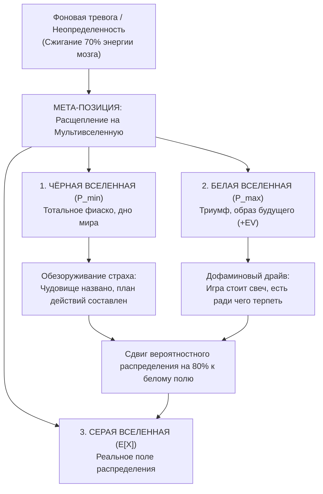

# 🌌 Как победить страх // Проектирование мультивселенной

> **«Безымянный страх парализует волю и сжигает весь когнитивный ресурс в фоновом режиме. Назови чудовище по имени, нарисуй худший сценарий до мельчайших деталей — и страх превратится в холодный расчет и план эвакуации.»**  
> — *Максим Олегович Коваль*

---

## ⚡ 01 // Главная суть (TL;DR)

Страх неизвестности и тревога перед будущим (страх завалить ЕГЭ, провалить защиту диплома, получить отказ, потерять отношения) — главные пожиратели энергии человека. В состоянии неопределенности мозг включает аварийный режим: миндалевидное тело (амигдала) заливает префронтальную кору кортизолом, блокируя логическое мышление и ввергая индивида в ступор или прокрастинацию.

Методология **«Мультивселенной исходов»** Максима Олеговича Коваля — это инженерная деконструкция тревоги, основанная на стоической практике *Premeditatio Malorum* и современной теории принятия решений. 

Вместо попыток «мыслить позитивно» мы принудительно расщепляем реальность на **три параллельные вселенные**:
1. **Чёрную** (тотальный крах),
2. **Белую** (триумфальный абсолют),
3. **Серую** (математически ожидаемую реальность, смещенную на 80% в плюс).

Выход в мета-позицию третьего лица нейтрализует аффект и превращает парализующий ужас в ракетное топливо для действий.

---

## 🧮 02 // Психологическая и вероятностная модель

### Архитектура расщепления реальности


### 1. Чёрная вселенная (Worst-Case Analysis)
- **Функция:** Обезоруживание амигдалы и локализация катастрофы.
- **Механизм:** Наш мозг боится не конкретных событий, а неопределенности. Когда ты в красках расписываешь: *«Я набрал 40 баллов, меня отчислили, я работаю грузчиком на складе в Шадринске, живу в съемной комнате»*, мозг внезапно понимает: **«Я от этого не умер. Моя биологическая жизнь продолжается, из этой точки есть понятный алгоритм выхода»**. Градус панической важности падает до нуля.
- **Инженерный выхлоп:** Выявление критической цепочки отказов ($F_1 \to F_2 \to F_3$), которая ведет на дно, и возведение барьеров против каждого звена.

### 2. Белая вселенная (Best-Case Pull)
- **Функция:** Синтез мотивационного вектора и дофаминового запроса.
- **Механизм:** Стоицизм часто критикуют за фиксацию на негативе. МО подчеркивает: **одного худшего сценария недостаточно!** Если видеть только черную вселенную, человек погружается в циничную депрессию. Белая вселенная показывает сияющий образ будущего: *«300 баллов, 100% грант Иннополиса, топовое комьюнити инженеров, зарплата 300к+ в Go-разработке, идеальная форма в зале»*.
- **Инженерный выхлоп:** Мозг выделяет энергию только под яркий, желанный образ будущего. Белая вселенная доказывает организму: *«Игра стоит свеч, инвестиции окупятся стократно»*.

### 3. Серая вселенная (Реалистичное байесовское смещение)
- В природе крайние точки распределения (чистый черный или чистый белый исход) случаются с вероятностью менее 2–3%. Жизнь всегда разворачивается в серой зоне между ними.
- Однако человек, выполнивший деконструкцию, перестает быть пассивным листом на ветру. Зная, как обойти черные ямы и куда ведет белая траектория, он **смещает математическое ожидание серой зоны на 80% в сторону триумфа**.

---

## 🔬 03 // Мета-позиция: Взгляд внешнего советника

Главный барьер при работе со страхом — нахождение внутри собственного эмоционального контура. В аффекте лимбическая система воспринимает угрозу социальному статусу (провал экзамена) как угрозу физической смерти от саблезубого тигра.

```
[ПРАВИЛО ТРЕТЬЕГО ЛИЦА]
Представь, что эта ситуация происходит НЕ С ТОБОЙ.
К тебе на консультацию пришел близкий друг или клиент с этой проблемой.
Ты — его холодный, высокооплачиваемый стратегический советник.
Опиши ему три вселенные и выдай директивный протокол действий.
```

Взгляд со стороны мгновенно активирует дорсолатеральную префронтальную кору, купируя панический всплеск норадреналина.

---

## 🕳️ 04 // Когнитивные слепые зоны при работе со страхом

| Ловушка | Ошибочный паттерн | Системные последствия |
| :--- | :--- | :--- |
| **Страусиная слепота** | «Я не буду думать о плохом, чтобы не притягивать негатив». | Неподготовленность к сбоям, панический паралич при первой же внештатной ситуации на экзамене. |
| **Катастрофизация без выхода** | Бесконечное прокручивание в голове картинки провала без составления плана действий. | Истощение надпочечников, хронический высокий кортизол, бессонница, поломка иммунитета. |
| **Токсичный позитив** | Самовнушение «всё будет супер», игнорируя реальные пробелы в знаниях. | Столкновение с суровой реальностью заканчивается тяжелым нарциссическим коллапсом. |

---

## 🛡️ 05 // Системные выводы Кодекса

1. **Страх — это не враг, а компас**: Страх безошибочно указывает на зону твоей максимальной уязвимости. Там, где страшно — там лежит твой следующий уровень силы.
2. **Черный сценарий освобождает**: Прожив худший сценарий на бумаге, ты становишься неуязвимым. Тебя больше нельзя запугать или сломать, потому что ты уже принял худшее и знаешь, что будешь делать.
3. **Белый сценарий направляет**: Без яркой белой вселенной дисциплина превращается в самоистязание. Держи образ победы перед глазами каждое утро.

---

## 🔗 Связанные материалы

- Практический протокол: [[Упражнение - Деконструкция худшего сценария]]
- Действие при панике: [[Конспект - Возглавь безумие]]
- Авторская позиция: [[Конспект - Инверсия ответственности]]
- Математика исходов: [[Конспект - Мультивселенная исходов (Контра ошибки выжившего)]]
- Карта модуля: [[03_Knowledge/Мышление и Продуктивность/README|База Знаний: Мышление, Энергия и Осознанность]]
