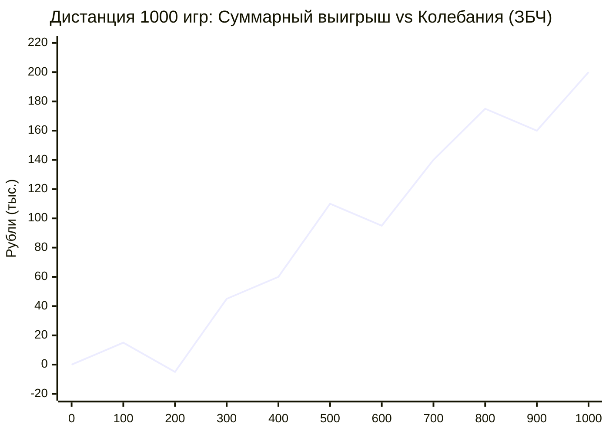

# 🎲 Как фармить плюсовость // Закон больших чисел и +EV

> **«Никогда не суди о правильности решения по исходу одной попытки. Оценивай математическое ожидание ставки. Если ставка плюсовая — делай её каждый день. Закон больших чисел на дистанции сотрет любую неудачу и гарантированно сделает тебя победителем.»**  
> — *Максим Олегович Коваль*

---

## ⚡ 01 // Главная суть (TL;DR)

Большинство людей терпят жизненное фиаско из-за фундаментальной математической безграмотности: они путают **качество решения** с **результатом единичного испытания** (*Outcome Bias*). Если человек совершил глупое действие с отрицательным мат. ожиданием (сел пьяным за руль или списал домашку), но ему повезло, он решает, что поступил правильно. Если он совершил выверенное действие с положительным мат. ожиданием (усердно учил теорию, но на пробнике попался неудачный авторский номер), он впадает в уныние и бросает работу.

Философия **«Фарма плюсовости»** основана на двух столпах теории вероятностей:
1. **Математическое ожидание ($EV$)**: расчет средней ценности действия.
2. **Закон больших чисел (ЗБЧ)**: доказательство того, что при многократном повторении случайные колебания нивелируются, а суммарный результат сходится к произведению $N \times EV$.

Тот, кто принимает решения с $+EV$, может терпеть локальные поражения (даунсвинги), но на дистанции года он математически обречен на триумф.

---

## 🧮 02 // Математическая модель: Барабан Коваля

### 1. Формула математического ожидания
Пусть дискретная случайная величина $X$ (исход события) принимает значения $x_1, x_2, \dots, x_n$ с вероятностями $p_1, p_2, \dots, p_n$, где $\sum p_i = 1$.  
Математическое ожидание (Expected Value) определяется как:

$$E(X) = \sum_{i=1}^n p_i x_i$$

### 2. Эксперимент с барабаном из лекции
Представьте барабан, разделенный на 10 равных секторов:
- 6 белых секторов ($P(\text{белый}) = \frac{6}{10} = 0.6$).
- 4 черных сектора ($P(\text{черный}) = \frac{4}{10} = 0.4$).

**Условия игры:**
- Выпадение белого: выигрыш $+3\,000$ рублей.
- Выпадение черного: проигрыш $-4\,000$ рублей.

```
       ┌─────────────────────────────────────────────────────┐
       │             РАСЧЕТ МАТЕМАТИЧЕСКОГО ОЖИДАНИЯ         │
       │                                                     │
       │   E(X) = 0.6 * (+3 000) + 0.4 * (-4 000)            │
       │   E(X) = +1 800 - 1 600                             │
       │   E(X) = +200 рублей за одну игру                   │
       └─────────────────────────────────────────────────────┘
```

**Фундаментальный парадокс:**
В одной игре вы физически не можете получить 200 рублей — вы либо потеряете 4 000, либо выиграете 3 000. Но математическая сущность игры — **строго плюсовая ($EV = +200$)**. В такую игру выгодно играть бесконечно!

### 3. Закон больших чисел (ЗБЧ) и асимптотика дистанции
По закону Чебышёва / Хинчина при $N \to \infty$ среднее арифметическое результатов сходится по вероятности к математическому ожиданию:

$$\lim_{N \to \infty} P\left(\left|\frac{1}{N}\sum_{i=1}^N X_i - E(X)\right| < \varepsilon\right) = 1$$



- **Апсвинг (Upswing)**: локальная полоса везения (серия белых секторов подряд). Не является признаком гениальности.
- **Даунсвинг (Downswing)**: локальная просадка (серия черных секторов подряд). Не является поводом менять систему.
- **Итог на $N = 1\,000$ игр**: Выигрыш составит $\approx 1\,000 \times 200 = \mathbf{200\,000}$ рублей.
- **Итог на $N = 1\,000\,000$ игр**: Выигрыш составит $\approx \mathbf{200\,000\,000}$ рублей.

---

## 🔬 03 // Прикладной фарм плюсовости в жизни и учебе

Каждое действие в течение дня — это ставка с определенным $EV$:

| Тип действия | Структура вероятностей и выплат | Знак $EV$ | Результат на дистанции 1 года ($N = 365$) |
| :--- | :--- | :--- | :--- |
| **Скроллинг Reels / Shorts** | 99% шанс: дофаминовая яма, потеря 2 часов, расфокус.<br/>1% шанс: смешной мем. | **$EV \ll 0$** | Разрушенная дофаминовая система, деградация рабочей памяти, провал дедлайнов. |
| **Сон 8 часов по режиму** | 95% шанс: ясная голова, восстановление ЦНС, высокий IQ.<br/>5% шанс: недосып из-за шума за окном. | **$EV \gg 0$** | Устойчивый иммунитет, способность удерживать фокус в течение 4 часов Deep Work. |
| **Решение задачи с параметром №18 на паузе (3-5 мин)** | 60% шанс: решил сам, сформировал новые синапсы.<br/>40% шанс: застрял, но подготовил мозг к усвоению подсказки. | **$EV \gg 0$** | 100 баллов на профиле, победа над любым нестандартным условием на реальном ЕГЭ. |
| **Списывание ДЗ из ГДЗ / готового решения** | 90% шанс: сохранил 30 минут сегодня.<br/>100% гарантия: не развил навык вывода формул. | **$EV \ll 0$** | Ступор и 0 баллов за вторую часть на бланках реального экзамена. |

---

## 🕳️ 04 // Когнитивные слепые зоны и эмоциональный саботаж

1. **Нетерпимость к даунсвингам**: Человек 2 недели соблюдает дисциплину, решает задачи, но на пробнике получает балл ниже предыдущего. Мозг в панике кричит: *«Это не работает!»*. Человек бросает $+EV$ систему. Это ошибка дилетанта, не понимающего дисперсию.
2. **Ловушка первого успеха (Beginner's Luck)**: Человек один раз за ночь до зачета выпил энергетик, сдал на шару и решил, что это рабочая методика. Он закрепил привычку с жестко отрицательным $EV$, которая на дистанции сессии гарантированно приведет к отчислению.
3. **Отказ от мелких плюсовых ставок**: «Подумаешь, 15 минут почитал документацию Go, погоды не сделает». Люди недооценивают сложный процент ЗБЧ: 15 минут $+EV$ каждый день дают 90 часов элитной практики в год.

---

## 🛡️ 05 // Системные правила покерного мышления

```
[ПРАВИЛО СКАЛОЛАЗА И ПОКЕРИСТА]
Оценивай только качество своей ставки.
Ты не властен над тем, какая карта выйдет на ривере сегодня.
Но если твоя ставка математически плюсовая — ставь не колеблясь.
Дистанция всё вернет с процентами.
```

1. **Изоляция от сиюминутного исхода**: Запрети себе рефлексировать над результатами одного дня или одного пробника. Рефлексируй над тем, выполнил ли ты протокол действий.
2. **Стабильный банкролл-менеджмент**: Не ставь на кон всё здоровье или все ресурсы в одном спринте. Играй так, чтобы пережить любой локальный даунсвинг.
3. **Накопительный эффект (Compound Effect)**: Фарм плюсовости не дает мгновенного взрыва. График долго колеблется возле нуля, а затем уходит в экспоненту по закону больших чисел.

---

## 🔗 Связанные материалы

- Практический протокол: [[Упражнение - Проектирование плюсовых математических ставок]]
- Разбор вероятностей: [[Конспект - Мультивселенная исходов (Контра ошибки выжившего)]]
- Управление страхом поражения: [[Конспект - Как победить страх (Создай мультивселенную)]]
- Карта модуля: [[03_Knowledge/Мышление и Продуктивность/README|База Знаний: Мышление, Энергия и Осознанность]]
