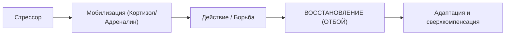

# 🧬 Конспект: Кортизол — друг или враг человека

> *"Кортизол — не финальный босс-разрушитель твоего тела. Это тревожный, гиперактивный, но жизненно необходимый менеджер по чрезвычайным ситуациям. Проблема возникает не тогда, когда он поднимается, а когда стрессовая система неделями не получает сигнала «Отбой»."*  
> — **Максим Олегович Коваль**

---

## 🎯 Главная суть

В популярной культуре кортизол демонизирован: его обвиняют в наборе веса, потере мышц, тревожности и выгорании. Однако без кортизола человек бы не проснулся утром, не смог бы адаптироваться к физической нагрузке и погиб бы от первого же воспалительного шока.

**Кортизол — это гормон адаптации и мобилизации**. Он перераспределяет ресурсы тела в пользу выживания и решения экстренных задач. Проблема кроется не в самом гормоне, а в **хронической дисрегуляции**: когда организм неделями удерживается в режиме боевой готовности без фазы восстановления.

---

## ⚠️ Анатомия проблемы (Почему 90% делают наоборот)

### 1. Феномен «Белого листа» на экзамене (Исследование Тома Смита)
Частая трагедия: ученик дома идеально решал задачи с параметром, мог объяснить теорию коту или однокласснику. Но зайдя в аудиторию на экзамен, видит бланк — и в голове загорается «экран вечной загрузки».

- **Научная база**: в эксперименте Тома Смита (76 участников) моделировался стресс перед извлечением ранее выученной информации. Группа под стрессом показала резкое ухудшение воспроизведения, особенно эмоционально окрашенных данных.
- **Механизм**: высокий уровень кортизола и катехоламинов временно блокирует доступ к префронтальной коре и гиппокампу. Знания не стерты — временно сломан интерфейс их извлечения.

### 2. Исчезновение фазы «Отбой»
Здоровая стресс-реакция циклична:



**Катастрофа 90% людей**: пункт «Восстановление» полностью стерт. Неопределенность, конфликты, соцсети и ночной недосып удерживают систему в постоянном возбуждении. В итоге надпочечники и рецепторы истощаются, возникает хронический синдром утомления.

---

## 🧠 Ключевые ментальные модели и законы

### 1. Командная цепочка: Ось ГГНО (HPA Axis)

Кортизол синтезируется в коре надпочечников, но подчиняется строгой иерархии:

```
[ Мозг: восприятие угрозы ]
           │
           ▼
     ГИПОТАЛАМУС  (выделяет Кортиколиберин / CRH)
           │
           ▼
       ГИПОФИЗ    (выделяет АКТГ — адренокортикотропный гормон)
           │
           ▼
  КОРА НАДПОЧЕЧНИКОВ  (синтез КОРТИЗОЛА)
           │
           ▼
[ Глюконеогенез в печени | Сосудистый тонус | Подавление второстепенных функций ]
```

Любая психологическая угроза (страх провалить ЕГЭ, звонок начальника, неопределенность будущего) запускает эту биологическую цепочку точно так же, как встреча с диким хищником.

---

### 2. Суточный график кортизола (CAR — Cortisol Awakening Response)

Кортизол — циркадный гормон. Его концентрация жестко завязана на астрономическое время:

```
Уровень кортизола
 ▲
 │         ▲ (Утренний пик через 30-45 мин после пробуждения: CAR)
 │        / \
 │       /   \
 │      /     \
 │     /       ─────── (Плавный спад днем)
 │    /               \
 │   /                 \
 └──┴───────────────────┴────────► Время суток
   06:00     12:00    18:00   00:00 (Минимум для синтеза мелатонина)
```

- **Утренний пик (CAR)**: физиологическая норма. Он обеспечивает выброс глюкозы, повышение артериального давления и включение сознания.
- **Вечерний минимум**: необходим для включения шишковидной железы и выработки гормона сна — мелатонина. Яркий свет экранов и вечерний стресс сбивают этот спад.

---

### 3. Завершение физиологического стресс-цикла

Кортизол готовит мышцы к интенсивному сокращению («бей или беги»). Если после стрессового триггера человек остается неподвижным, метаболиты стресса циркулируют в крови, поддерживая спазм сосудов и тревогу.  
**Единственный биологический способ завершить цикл** — физическое движение: интенсивная ходьба, отжимания, приседания, плавание или растяжка. Тело сжигает мобилизованную глюкозу и дает мозгу сигнал: *«Опасность миновала, враг побежден»*.

---

## ⚡ Системные выводы

1. **Не воюй с кортизолом**: используй его утренний естественный пик для решения самых тяжелых задач (Prime Time).
2. **Экзаменационный ступор лечится заземлением**: если на контрольной заклинило память — это кортизоловый спазм. Медленное дыхание 4–6 и мышечный сброс возвращают доступ к гиппокампу.
3. **Физический труд после стресса обязателен**: понервничал — пройдись пешком 3 км или сделай подход подтягиваний. Закрой цикл мобилизации.
4. **Свет по утрам, темнота по вечерам**: естественный солнечный свет в глаза в первые 30 минут пробуждения калибрует всю ось ГГНО на 24 часа вперед.

---

## 🔗 Связанные материалы

- Практический протокол управления: [[Упражнение - Кортизол — друг или враг человека]]
- Работа со стрессом в моменте: [[Конспект - Стресс и трехуровневая саморегуляция]]
- Биологические ритмы: [[Конспект - Биологические пики и защита Prime Time]]
