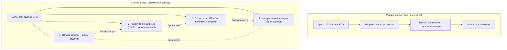

# 📐 Метрика здравого смысла (МЗС) // Контра-Гудхарт

> **«Как только показатель становится целью, он перестает быть хорошим показателем. Единственное спасение от самообмана — многомерная замкнутая система метрик, которую невозможно эксплуатировать без реального движения к цели.»**
> — *Максим Олегович Коваль*

---

## ⚡ 01 // Главная суть (TL;DR)

Человеческий мозг — ленивый оптимизатор. При постановке любой цели (сдать ЕГЭ на 100 баллов, изучить Go на уровне Middle, построить бизнес, сбросить вес) мозг стремится свести сложный многофакторный процесс к **одному простому скалярному числу** (например: «отсидеть 8 часов за столом» или «решить 30 задач в день»).

Как только этот единственный показатель выбран, вступает в силу **Закон Гудхарта**: индивид бессознательно или осознанно начинает накручивать сам показатель в ущерб глубинному результату. Он сидит за столом 8 часов в прострации с телефоном или решает 30 шаблонных, уже знакомых легких задач, создавая иллюзию бурной деятельности.

**Метрика Здравого Смысла (МЗС)** — это инженерный фреймворк построения **векторной системы взаимодополняющих метрик**, обладающей свойством неизбыточности и полноты. В сбалансированной системе МЗС «взломать» один показатель нельзя, так как соседние метрики жестко зафиксируют просадку качества.

---

## 🧮 02 // Математическая и логическая модель

### 1. Скалярная ловушка vs Вектор состояния
Пусть целевое состояние системы описывается вектором реальной готовности $\vec{R} \in \mathbb{R}^n$.
Попытка свести оценку к скалярной функции $m(t) \in \mathbb{R}$ приводит к вырождению:

$$m(t) \to \max \quad \centernot\implies \quad \vec{R}(t) \to \vec{R}_{\text{target}}$$

При скалярной оптимизации градиент усилий направляется вдоль пути наименьшего сопротивления, максимизируя суррогат $m$, а не реальный базис знаний.

### 2. Принцип полноты системы МЗС
Система метрик $\mathcal{M} = \{m_1, m_2, \dots, m_k\}$ называется **полной по Гудхарту**, если не существует такой траектории поведения $X(t)$, при которой:

$$\forall i \in \{1, \dots, k\}: \Delta m_i \ge 0 \quad \text{и при этом} \quad \Delta \vec{R} \le 0$$

Иными словами: **невозможно одновременно поднять все метрики системы, не совершив реального качественного прорыва**.

### 3. Тетраэдр академической устойчивости (Кейс ЕГЭ / Олимпиад)
Максим Олегович Коваль выделяет четыре ортогональных вектора, образующих минимальную замкнутую систему метрик для фундаментального обучения:

1. **Входная метрика (Input)**: Объем чистого структурированного материала (просмотренные лекции по порядку, конспекты без перемотки).
2. **Метрика активного вывода (Active Recall)**: Объем самостоятельно решенных задач из ДЗ *до* разбора решений (процент задач, доведенных до ответа на паузе).
3. **Метрика верификации в боевых условиях (Hard Verification)**: Написание полных вариантов в условиях экзамена (жесткий тайминг, без шпаргалок, без кураторов, в незнакомой обстановке).
4. **Метрика ликвидации дефектов (Refactoring)**: Повторное решение неверно выполненных номеров спустя 7–14 дней.

---

## 🕳️ 03 // Когнитивные слепые зоны и паразитные паттерны

| Когнитивная ловушка | Механизм самообмана | Проявление в реальности |
| :--- | :--- | :--- |
| **Иллюзия компетентности** | Пассивное восприятие путается с активным навыком. | «Я посмотрел 5 часов вебинаров Школково, всё понял, я гений». В боевом тесте — ступор на 1-й минуте. |
| **Паразит подсказок** | Использование шпаргалок/решебников в процессе ДЗ. | «Я просто подсмотрю формулу/хинт, на экзамене-то я вспомню». Формируется зависимость от внешнего триггера. |
| **Синдром знакомой колеи** | Выбор задач того типа, который уже получается на автомате. | Прокрастинация сложных тем (№18 параметры, №19 теория чисел) нарешиванием простых задач первой части. |
| **Эксплуатация куратора** | Делегирование мыслительного усилия на ранней фазе. | Обращение к куратору/нейросети через 60 секунд после прочтения условия вместо 5 минут самостоятельного штурма. |

---

## 🏛️ 04 // Системные выводы и правила Кодекса

1. **Правило динамического баланса**: Система метрик не статична. По мере роста компетенции метрики нижнего уровня (просмотр теории) отключаются, уступая место метрикам высшего порядка (время решения параметров, процент безошибочности вычислений).
2. **Тест на уязвимость (Взлом системы)**: Раз в 2 недели проведи аудит своей системы метрик с вопросом: *«Если бы я был злонамеренным лентяем, как бы я накрутил эти графики без пользы для дела?»*. Найденная лазейка должна быть немедленно перекрыта новой контр-метрикой.
3. **Метрика без жесткой верификации — мусор**: Если в твоей системе нет слепого независимого среза (пробник на бланках, код-ревью сеньора, деплой в прод), твоя система гарантированно коррумпирована мозгом.

---

## 🔗 Связанные материалы

- Практический протокол: [[Упражнение - Проверка решений по шкале МЗС]]
- Углубленная лекция: [[Конспект - Закон Гудхарта]]
- Общая архитектура базы: [[03_Knowledge/Мышление и Продуктивность/README|База Знаний: Мышление, Энергия и Осознанность]]
