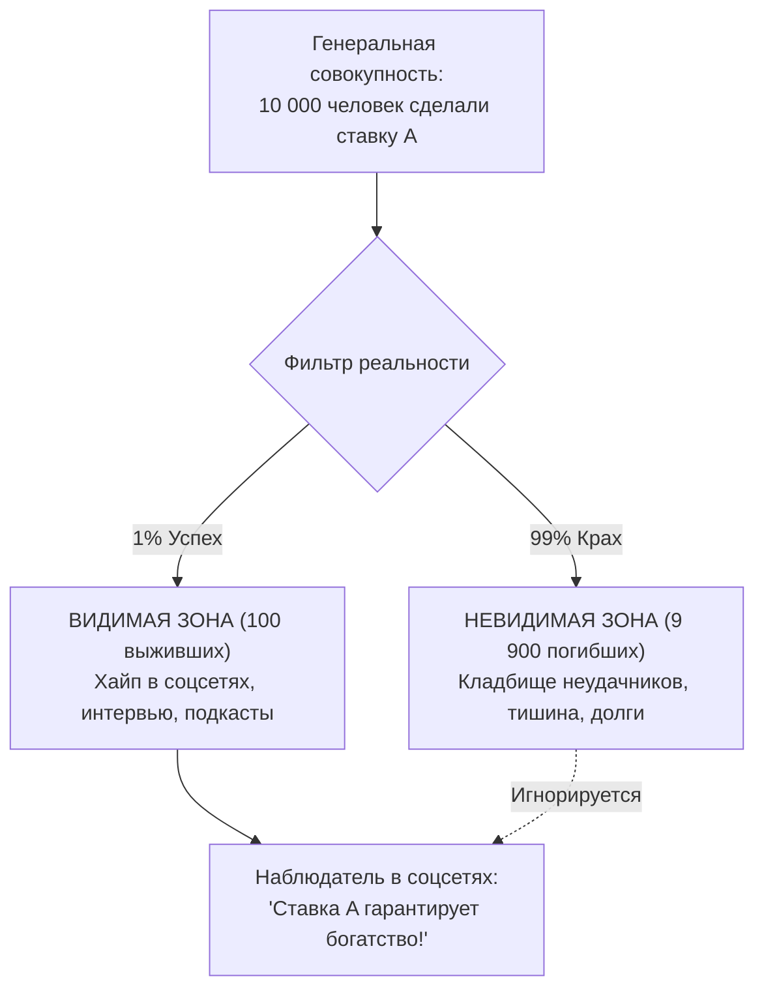

# 🌌 Мультивселенная исходов // Контра-Ошибка выжившего

> **«Мы видим одну минуту триумфа в коротком видео и не видим десяти лет каторжной базы за кадром. Но хуже всего — мы не видим кладбища из сотен тех, кто сделал ту же ставку и остался на обочине жизни.»**  
> — *Максим Олегович Коваль*

---

## ⚡ 01 // Главная суть (TL;DR)

**Ошибка выжившего (Survivorship Bias)** — это систематическое когнитивное искажение, при котором человек делает глобальный вывод обо всей генеральной совокупности, анализируя исключительно объекты, прошедшие фильтр отбора (победителей, миллионеров, стобалльников), и полностью игнорируя тех, кто выбыл в процессе.

В эпоху клипового контента это искажение приобрело характер эпидемии: 30-секундный ролик о «парне, который бросил школу и поднял миллионы на крипте» или «стобалльнике, который начал ботать за месяц до экзамена», провоцирует людей слепо копировать чужое безумие.

Концепция **«Мультивселенной исходов»** — это строгий математический протокол деконструкции чужого успеха. Вместо эмоционального обесценивания («он всё врет») или слепого подражания («я сделаю так же»), мы раскладываем результат на **частичную правду**, **скрытый фундамент контекста**, **альтернативные ветки реальности** и **невидимое кладбище исходов**.

---

## 🧮 02 // Математическая модель селективного смещения

### 1. Формула скрытой выборки (Байесовский срез)
Пусть исход генеральной совокупности делится на выживших $S$ (Survivors) и погибших $D$ (Dead/Defeated).  
Наблюдатель имеет доступ только к условному распределению:

$$P(\text{Действие } A \mid S) = \frac{P(S \mid A) P(A)}{P(S)}$$

Ошибка выжившего заключается в ошибочном предположении, что:

$$P(S \mid A) \approx P(A \mid S)$$

Если 90% успешных предпринимателей бросили университет, это **не** означает, что отчисление из университета с вероятностью 90% сделает вас успешным предпринимателем!



### 2. Абрахам Вальд и геометрия брони
Классический пример Второй мировой войны: венгерский математик Абрахам Вальд анализировал пробоины на вернувшихся бомбардировщиках союзников. Командование собиралось укреплять фюзеляж и крылья, где дыр было больше всего.  
Вальд доказал обратное: **укреплять нужно двигатели и топливные баки, потому что самолеты с повреждениями в этих местах просто не долетали до аэродрома**. В жизни самые важные данные всегда лежат на кладбище невернувшихся самолетов.

---

## 🔬 03 // Анатомия кейса: «Продал квартиру — стал миллиардером»

Максим Олегович Коваль на собственном примере разбирает, как ролик-вырезка искажает реальность:

| Слой информации | Что транслирует медиа-витрина | Что скрыто в реальном контексте (Вся правда) |
| :--- | :--- | :--- |
| **Кликбейтный нарратив** | «Максим Коваль продал квартиру, вложил деньги в IT-платформу и построил империю Школково». | Кажется авантюрой отчаянного смельчака, поставившего всё на «зеро». |
| **Базис и активы** | За кадром. | У Коваля уже была мощная сеть очных репетиторских центров, сильнейший пул преподавателей, колоссальный поток учеников и растущая выручка. |
| **Степень риска** | «Рискнул единственным жильем». | Квартира была недорогим вторичным активом в Санкт-Петербурге за 5 млн руб. Потеря этих денег была неприятна, но абсолютно безопасна для жизни. |
| **Мультивселенная исходов** | Показана только ветка триумфа. | Если бы платформа провалилась, Коваль остался бы топовым репетитором Москвы с действующим бизнесом. |

Если школьник или студент, не имея бизнеса, продаст единственную квартиру семьи и вложит в идею без готового рынка — с вероятностью 99.9% в ветке своей мультивселенной он окажется на улице с долгами.

---

## 🕳️ 04 // Две крайности когнитивного тупика

1. **Токсичное обесценивание (Нигилизм)**:
   - *Мысль:* «Он врет, ему помогли богатые родители, все вокруг инфоцыгане».
   - *Цена ошибки:* Защитная реакция эго блокирует способность учиться у реальных профессионалов. Человек консервирует свою беспомощность.
2. **Слепой карго-культ (Ошибка выжившего)**:
   - *Мысль:* «Я просто повторю внешние атрибуты: куплю черную водолазку как у Джобса / буду спать по 4 часа / брошу колледж».
   - *Цена ошибки:* Повторение внешних симптомов без воспроизведения фундаментальной базы ведет к гарантированному краху.

---

## 🛡️ 05 // Инженерный протокол деконструкции успеха

```
[ПРИНЦИП ПОЛНОЙ ПРАВДЫ]
Никогда не оценивай действие изолированно от контекста агента.
Задай три вопроса:
1. Какой фундамент был построен ДО этого шага?
2. Что случилось с теми, кто сделал этот шаг без фундамента?
3. Какова реальная цена победы в ресурсах здоровья, времени и нервов?
```

1. **Реконструкция невидимого айсберга**: Погрузи новость в контекст: образование, семья, финансовая подушка, 10 000 часов практики.
2. **Оценка качества процесса, а не результата (Outcome Bias)**:
   - Победа в русской рулетке не делает ставку умной.
   - Сдача ЕГЭ на 100 баллов при подготовке за 2 недели — это экстремальная флуктуация дисперсии (попался идеальный вариант), а не воспроизводимая стратегия.
3. **Аудит истинной цены**: Узнай, чем заплатил победитель. Если платой стали разрушенные суставы, панические атаки и одиночество — готов ли ты подписать этот контракт?

---

## 🔗 Связанные материалы

- Практический протокол: [[Упражнение - Моделирование дерева альтернативных исходов]]
- Теория ставок: [[Конспект - Как фармить плюсовость (Закон больших чисел)]]
- Анализ уверенности: [[Конспект - Голый король (Контра Даннинга-Крюгера)]]
- Карта модуля: [[03_Knowledge/Мышление и Продуктивность/README|База Знаний: Мышление, Энергия и Осознанность]]
