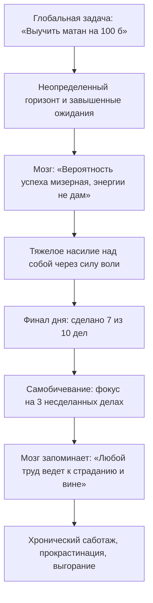

# ⚡ Конспект: Пожиратели энергии и системный цикл ПДВ

> *"Бесконечные задачи — главные пожиратели энергии и убийцы мотивации. Прежде чем строить тайм-менеджмент, научись безупречно закрывать одну локальную задачу по циклу ПДВ."*  
> — **Максим Олегович Коваль**

---

## 🎯 Главная суть

Попытка составить расписание или приоритизировать дела без отлаженного механизма работы с отдельной задачей приводит к быстрому выгоранию. Главный двигатель человеческой деятельности — **дофамин**. Это не гормон кайфа от финала, а **нейромедиатор предвкушения и мобилизации ресурсов**.

Фундаментальный инструмент управления дофамином — **Цикл ПДВ**:
$$\text{Предвкушение (П)} \longrightarrow \text{Действие (Д)} \longrightarrow \text{Вознаграждение (В)}$$

Если этот цикл сломан (завышенные ожидания, бесконечные неразрешимые задачи, отсутствие наград в финале), мозг фиксирует негативный опыт и в следующий раз отказывается выделять энергию на старт.

---

## ⚠️ Анатомия проблемы (Почему 90% делают наоборот)

Большинство амбициозных людей неосознанно выстраивают разрушительную систему взаимодействия с собственным мозгом:



### Главные ошибки 90% людей:
1. **Бесконечные задачи без финиша**: задачи формулируются как «ботать физику» или «писать диплом». У мозга нет критерия завершения, дофамин не выделяется, энергия утекает как сквозь сито.
2. **Токсичный перфекционизм**: в конце продуктивного дня человек игнорирует выполненный объем и грызет себя за то, что не успел. В итоге день закрывается с отрицательным эмоциональным балансом.
3. **Быстрый дешевый дофамин как заглушка**: пытаясь заглушить тревогу, человек уходит в соцсети, фастфуд или видеоигры. Рецепторы дофамина загрубляются, и учеба начинает казаться невыносимо серой.

---

## 🧠 Ключевые ментальные модели и законы

### 1. Анатомия идеального цикла ПДВ

```
  ┌─────────────────┐       ┌─────────────────┐       ┌─────────────────┐
  │  ПРЕДВКУШЕНИЕ   │ ────> │    ДЕЙСТВИЕ     │ ────> │ ВОЗНАГРАЖДЕНИЕ  │
  │ • Образ финиша  │       │ • Атомный шаг   │       │ • Самопохвала   │
  │ • Баланс шансов │       │ • Чистый фокус  │       │ • Фиксация (✔)  │
  └─────────────────┘       └─────────────────┘       └─────────────────┘
           ▲                                                   │
           └─────────── Накопление позитивного опыта ──────────┘
```

#### Фаза П: Предвкушение (Калибровка ожиданий)
Мозг выделяет энергию только тогда, когда видит баланс между сложностью и достижимостью:
- **Завышенные ожидания ($P \to 0$)**: мозг считает цель нереальной и экономит ресурс.
- **Заниженные ожидания ($P \to 1$ без труда)**: мозг не видит вызова, дофамин не выделяется («это случится само»).
- **Золотая середина**: *«Если я сейчас напрягусь и приложу 100% фокуса, я гарантированно получу этот результат»*.

#### Фаза Д: Действие (Декомпозиция)
Любая многочасовая задача обязана быть разрезана на автономные кванты по 30–90 минут с ясным физическим финишем (например: «разобрать 3 задачи на экономику №16» вместо «ботать экономику»).

#### Фаза В: Вознаграждение (Закрытие гештальта)
- **Физическое вычеркивание**: перечеркнуть задачу ручкой или поставить чекбокс в Obsidian — это мощнейший физиологический триггер выброса дофамина.
- **Безусловная похвала**: сказать себе «Красавчик, сделано чисто!», поделиться успехом с бадди или близкими.
- **Осознанное удовольствие**: разрешить себе качественный отдых, прогулку или любимое хобби без чувства вины.

---

### 2. Закон линии прогресса (Streak Effect)

Каждый закрытый чекбокс образует непрерывную цепь:

$$\mathbf{[X] \longrightarrow [X] \longrightarrow [X] \longrightarrow [X] \longrightarrow [X]}$$

Когда человек видит цепочку из 4–5 побед подряд, включается мощный защитный психологический механизм: **мозг категорически не хочет разрывать линию успеха**. Мотивация дойти до конца дня или спринта возрастает в геометрической прогрессии с каждым новым закрытым пунктом.

---

### 3. Рефрейминг ошибок в обучении (Ошибки как диагностика)

| Событие | Логика неудачника (Слом ПДВ) | Логика исследователя (Системный ПДВ) |
| :--- | :--- | :--- |
| **Ошибки в пробнике / ДЗ** | *«Я тупой, 90+ мне не светит, подготовка бессмысленна»* | *«Отлично! Пробник бесплатно вскрыл 3 критических бага в знаниях до реального экзамена»* |
| **Эмоция** | Тильт, апатия, блокировка дофамина | Азарт, интерес, получение дофамина от закрытия найденных дыр |
| **Действие** | Бросает ботать на 3 дня | Немедленно разбирает теорию по проблемным номерам |

---

## ⚡ Системные выводы

1. **Не приступай к задаче без ясного финиша**: если ты не знаешь, как выглядит завершенная работа, мозг не даст на нее энергии.
2. **Сделай фиксацию успеха обязательным ритуалом**: не переходи к следующей задаче, пока не поставил отметку о победе и не зафиксировал удовлетворение.
3. **Защищай дофаминовые рецепторы**: не подменяй заслуженное вознаграждение за тяжелый труд дешевым цифровым мусором.
4. **Ошибки — это данные, а не приговор**: радуйся каждой найденной ошибке, пока она совершена на тренировочном полигоне, а не на реальном экзамене.

---

## 🔗 Связанные материалы

- Практический трекер недели: [[Упражнение - Пожиратели энергии и системный цикл ПДВ]]
- Фундамент ЗНТ: [[Конспект - Базовые настройки и образ мышления]]
- Следующая лекция: [[Конспект - Утечки энергии и закон больших чисел]]
