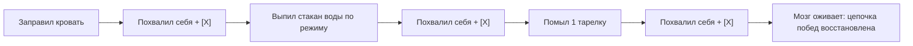

# 🧠 Конспект: Практический цикл ПДВ и чистый дофамин

> *"Дофамин — это локомотив твоей воли. Если цикл ПДВ сломан, ни один тайм-менеджмент в мире не заставит тебя сесть за работу. Почини механизм вознаграждения, начни хвалить себя за каждый реальный шаг, и мозг сам станет поставщиком энергии."*  
> — **Максим Олегович Коваль**

---

## 🎯 Главная суть

Нейромедиатор **дофамин** синтезируется в нейронах среднего мозга в ответ на **ожидание удовлетворения и приближение к цели**. Он повышает концентрацию внимания, обостряет восприятие и дает ощущение непрерывного драйва.

Существуют два типа дофамина:
1. **Чистый (заработанный) дофамин**: вырабатывается при преодолении реального интеллектуального или физического сопротивления по формуле ПДВ. Укрепляет психику, растит самоуважение и формирует устойчивую волю.
2. **Дешевый (суррогатный) дофамин**: результат потребления без усилий (бесконечный скроллинг Reels, сахар, никотин, порнография). Приводит к десенсибилизации D2-рецепторов, апатии и неспособности выдерживать даже 15 минут сложной когнитивной нагрузки.

---

## ⚠️ Анатомия проблемы (Почему 90% делают наоборот)

### 1. Трагедия «Сломанного цикла ПДВ»
К 17–20 годам подавляющее большинство людей подходят с тяжелой патологией дофаминового контура:
- В школе и дома их годами учили: ошибки — это позор, за хорошую работу хвалить не надо («это твоя обязанность»), а за малейший промах следует наказание и критика.
- **Нейробиологический итог**: мозг сформировал железобетонную связь:  
  $$\text{Учеба / Труд} \Longrightarrow \text{Обесценивание} + \text{Критика} + \text{Боль}$$
- В результате при попытке сесть за ботанику или сложный проект организм включает экстренный саботаж (прокрастинацию), чтобы защитить человека от гарантированной боли в финале.

### 2. Ловушки калибровки ожиданий
- **Ловушка занижения** (*«поставлю цель сдать на тройку, чтобы не расстраиваться»*): мозг видит вероятность 99% без труда и не выделяет ни капли дофамина («зачем тратить энергию на то, что случится само?»).
- **Ловушка завышения** (*«за 3 дня выучу весь курс высшей математики»*): мозг мгновенно оценивает вероятность как близкую к нулю и блокирует энерговыдачу («бесполезная трата ресурса»).

---

## 🧠 Ключевые ментальные модели и законы

### 1. Тонкая настройка триады ПДВ

```
  [ 1. ПРЕДВКУШЕНИЕ ] ───> [ 2. ДЕЙСТВИЕ ] ───> [ 3. ВОЗНАГРАЖДЕНИЕ ]
   • Адекватный образ       • Атомарный объем      • Физический крестик [X]
   • Баланс вероятности     • Изоляция фокуса      • Самопохвала вслух
   • Разделение УДОВЛ.      • 25-50 минут          • Социальное признание
     и УДОВОЛЬСТВИЯ                                • Осознанный отдых
```

#### Разделение Удовлетворения и Удовольствия:
- **Удовлетворение**: глубокое внутреннее чувство *«Я сделал это, я удержал планку, я стал сильнее»*. Это базовое вознаграждение, которое должно присутствовать в 100% задач.
- **Удовольствие**: внешняя сенсорная радость (пирожное, поход в кино, покупка вещи).  
  > **Закон МО**: удовольствие можно добавлять как бонус только в самых тяжелых, поворотных задачах. Если привязывать еду или покупки к каждому повседневному шагу, ты создашь пищевую или потребительскую зависимость.

---

### 2. Реанимация при нулевой мотивации (Метод ультра-микро-шагов)

Если цикл ПДВ разбит вдребезги и человек находится на дне апатии, запрещено сразу штурмовать параметры или олимпиады. Нужно начать с примитивных бытовых действий:



Каждая закрытая микро-задача с искренней самопохвалой восстанавливает чувствительность рецепторов и возвращает человеку статус **Победителя**.

---

### 3. Социальный мультипликатор признания

Человек — социальный примат. Нам жизненно необходимо внешнее подтверждение статуса:
- Договорись с бадди, родителями или создай закрытый чат единомышленников.
- Отправь отчет: *«Парни, я закрыл сегодня 4 жестких номера по стереометрии, похвалите меня!»*.
- В ответ получаешь: *«Красавчик, машина, жми дальше!»*.
- Этот простой социальный импульс дает мощнейший всплеск эндогенных опиоидов и дофамина, цементируя привычку побеждать.

---

## ⚡ Системные выводы

1. **Никогда не оставляй победу безнаказанной**: сделал дело — обязательно похвали себя, порадуйся, перечеркни пункт жирной линией.
2. **Формируй ожидания в точке максимального усилия**: ставь планку так, чтобы для победы требовалось выложиться на 100%, но чтобы она была реально достижима.
3. **Ошибки — это бесплатные уроки**: не давай ошибке сломать цикл ПДВ. Ошибка в пробнике — это диагностика, а не оценка твоей личности.
4. **Очищай рецепторы**: убери дешевые стимуляторы, и обычное решение сложных математических задач снова начнет приносить неподдельный кайф.

---

## 🔗 Связанные материалы

- Практический протокол: [[Упражнение - Практический цикл ПДВ и чистый дофамин]]
- Системный контекст: [[Конспект - Пожиратели энергии и системный цикл ПДВ]]
- Работа со стрессом: [[Конспект - Стресс и трехуровневая саморегуляция]]
