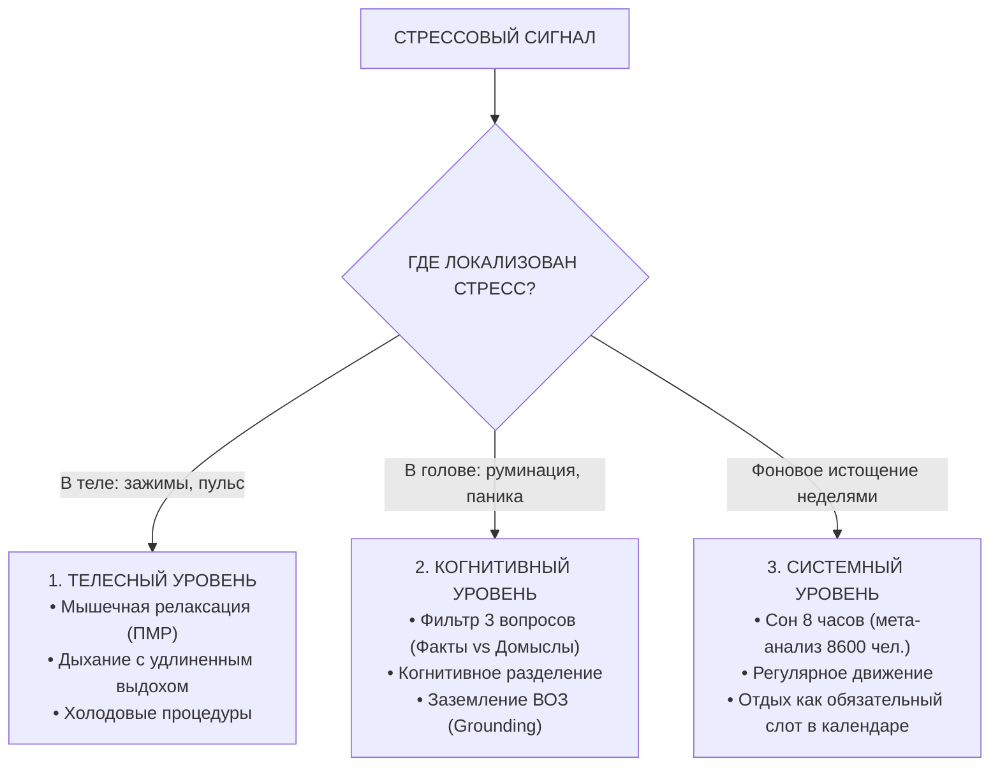

# 🛡️ Конспект: Стресс и трехуровневая саморегуляция

> *"Стресс — это естественная пожарная сигнализация организма. Проблема не в том, что она сработала, а в том, что мы живем так, будто она орет не замолкая годами. Перестань бороться со стрессом вслепую — определи, где он застрял: в теле, в мыслях или в хроническом образе жизни."*  
> — **Максим Олегович Коваль**

---

## 🎯 Главная суть

Стресс — это не враг и не патология, а эволюционная система адаптации и мобилизации ресурсов. Цель работы со стрессом — не превратиться в бесчувственное бревно, а научиться **дифференцировать природу стрессового ответа** и применять точечный инструмент под каждый из **3 уровней**:

1. **Телесный уровень**: гипертонус мышц, спазм челюсти, тахикардия, поверхностное дыхание.
2. **Когнитивный уровень**: руминация (мыслительная жвачка), катастрофизация, додумывание негативных сценариев.
3. **Хронический системный уровень**: фоновое истощение из-за нарушения сна, гиподинамии и отсутствия запланированного отдыха.

Попытка лечить телесный спазм логическими уговорами («не нервничай») так же бесполезна, как попытка лечить когнитивную панику холодным душем.

---

## ⚠️ Анатомия проблемы (Почему 90% делают наоборот)

### 1. Катастрофизация неопределенности (Кейс: «Зайди ко мне сегодня»)
Человек получает рядовое сообщение от начальника/учителя: *«Зайди ко мне сегодня»*.
- **Факты**: начальник попросил подойти. На этом объективная реальность заканчивается.
- **Фантазия 90% людей за 10 секунд**: *«Меня отчислят/уволят ➔ отберут квартиру ➔ я окажусь на улице без денег ➔ жизнь разрушена»*.
- **Итог**: человек испытывает полноценный физиологический шок не от реального события, а от **выдуманного сценария в собственной голове**.

### 2. Заблуждение об отдыхе как «награде»
Большинство считает: *«Сначала я закрою все долги, сдам все работы, отвечу на все сообщения, и вот ТОГДА я смогу с чистой совестью отдохнуть»*.  
**Ловушка**: дела обладают неприятным свойством никогда не заканчиваться. В итоге отдых откладывается месяцами, приводя к тяжелому соматическому срыву. Отдых — это **не приз**, а обязательный элемент расписания для обслуживания машины интеллекта.

---

## 🧠 Ключевые ментальные модели и законы

---

### 1. Уровень 1: Инструменты телесной регуляции

- **Прогрессивная мышечная релаксация (ПМР по Джекобсону)**:
  - *Научная база*: мета-анализ 2024 года (46 исследований, 3400+ участников) доказал достоверное снижение тревоги и соматического стресса.
  - *Принцип*: последовательное напряжение изолированной группы мышц на 5 секунд с последующим сбросом на 10 секунд и фиксацией контраста («напряжение ➔ расслабление»).
- **Управляемое дыхание с длинным выдохом**:
  - *Механизм*: вдох активирует симпатику (ускоряет пульс), длинный плавный выдох активирует блуждающий нерв и парасимпатику (замедляет синусовый узел сердца).

---

### 2. Уровень 2: Инструменты когнитивной регуляции

#### Фильтр трех вопросов:
При возникновении навязчивой тревожной мысли задай себе 3 жестких вопроса:
1. **Что из этого я знаю абсолютно ТОЧНО как факт?**
2. **Что из этого я прямо сейчас ДОДУМЫВАЮ?** (Осознать: ни один из этих кошмаров пока не произошел).
3. **Могу ли я прямо сейчас сделать одно конкретное действие?**
   - *Если ДА* ➔ сделать первый микро-шаг немедленно.
   - *Если НЕТ* ➔ зафиксировать мысль в дневник выгрузки и отложить до назначенного времени.

#### Техника когнитивного разделения (Cognitive Defusion):
- ❌ Было: *«Я завалю этот экзамен и сломаю жизнь»* (мысль воспринимается как свершившийся факт).
- ✅ Стало: *«Я замечаю, что мой мозг прямо сейчас подкидывает мне мысль о возможном провале»* (дистанцирование от мысли).

#### Протокол «Заземление» (Методика ВОЗ):
Когда эмоциональный шторм сбивает с ног:
1. Почувствуй стопы, плотно прижатые к полу, и опору под спиной.
2. Найди глазами **5 конкретных предметов** вокруг (ноутбук, ручка, лампа, кружка, окно).
3. Выдели **3 звука** в пространстве (гул кулера, шум машин за окном, собственное дыхание).
4. Ощути **2 тактильных контакта** (фактура ткани брюк, прохлада поверхности стола).

---

### 3. Уровень 3: Системная гигиена жизни

- **Сон как антидепрессант**: исследование 65 научных работ (8600+ участников) подтвердило, что нормализация фаз глубокого сна снижает уровень руминации и кортизола сильнее большинства фармакологических препаратов.
- **Движение**: минимум 30 минут аэробной или силовой нагрузки в день сжигает избыток циркулирующих катехоламинов.
- **Легализация отдыха**: отдых заносится в ежедневник ДО планирования работы.

---

## ⚡ Системные выводы

1. **Не превращай заботу о себе в новый стресс**: не пытайся внедрить 10 техник одновременно. Выбери один инструмент под текущий симптом.
2. **Разделяй факты и фантазии**: 90% страданий происходят в воображении по поводу событий, которые никогда не случатся в реальности.
3. **Возвращайся в тело**: если мозг горит от паники, отключи логику и начни с глубокого дыхания и заземления стоп.
4. **Задай главный вопрос**: если стресс стал хроническим — спроси себя: *«Мне действительно нужно еще одно дыхательное упражнение, или в моей жизни есть системная гниль, которую давно пора отрезать?»*.

---

## 🔗 Связанные материалы

- Практический тренинг: [[Упражнение - Стресс и трехуровневая саморегуляция]]
- Гормональная основа: [[Конспект - Кортизол — друг или враг человека]]
- Базовый фундамент ЗНТ: [[Конспект - Базовые настройки и образ мышления]]
