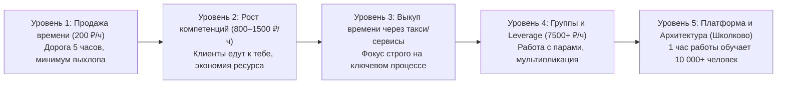

# 🧠 Конспект: У тебя нет ничего, кроме денег

> *"«Ты хотела купить меня, но ты беден — у тебя нет ничего, кроме денег». Деньги — это мощнейший инструмент, универсальный мультипликатор и средство выкупа твоего времени и внимания. Но если за этими цифрами нет внутреннего стержня, фундаментальных ценностей, дисциплины и большого образа будущего, человек остается нищим, сколько бы нулей ни лежало на его банковском счете."*  
> — **Максим Олегович Коваль**

---

## 🎯 Главная суть

Деньги в инженерной картине мира — это **не самоцель и не фетиш**, а **инструментальная шкала**, отражающая:
1. Эффективность твоей системы привычек и образа мышления.
2. Ценность и сложность задач, которые ты способен решать для мира.
3. Способность выкупать собственное внимание и делегировать низкоуровневую энтропию.

Заблуждение большинства молодых людей лежит в двух крайностях: либо романтизация нищеты («деньги — это грязь, главное духовность»), либо материальный цинизм («будут бабки — решится абсолютно все»). Истина в том, что деньги решают только материальные проблемы; экзистенциальные проблемы, дефицит смыслов и незрелость они лишь многократно усиливают.

---

## 📈 Эволюция стоимости часа и Leverage



### 1. Кейс МО: Поездка в Мытищи за 1000 рублей
- На старте карьеры репетитора МО ездил со станции «Университет» в Мытищи: 1.5 часа туда, 1.5 часа обратно, 2 часа занятия.
- **Математика**: 1000 рублей за 5 часов жизни = **200 рублей в час**.
- На этом этапе ты продаешь голое время по грабительскому курсу, потому что у тебя нет бренда, авторитета и наработанной технологии.
- Единственный бонус: бабушка ученицы кормила комплексным обедом (экономия 300 рублей для студента).

### 2. Шаг в сторону рычага: сокращение накладных расходов
- Как только уровень мастерства вырос, МО перестал выезжать: ученики стали приходить к нему сами.
- За те же 2 часа заработок вырос до 800–1000 рублей без траты 3 часов на электрички и метро. Ставка часа удвоилась мгновенно.

### 3. Инвестиция в выкуп ресурса: Кейс с такси
- При появлении первых свободных средств МО сделал неочевидный шаг: пересел на желтое такси с выделенной полосой.
- *Зачем?* Не ради пафоса, а ради ликвидации энтропии: не мерзнуть на остановке, не опаздывать, а сидеть в тепле на заднем сиденье и готовиться к следующим сложнейшим математическим занятиям. Деньги превратились в инструмент сохранения когнитивного потенциала.

---

## ♟️ Базовый студенческий гамбит

```
  ┌─────────────────────────────────────────────────────────────┐
  │                 БАЗОВЫЙ СТУДЕНЧЕСКИЙ ГАМБИТ                 │
  ├──────────────────────────────┬──────────────────────────────┤
  │       ОШИБКА КУРЬЕРА         │      СТРАТЕГИЧЕСКИЙ ХОД      │
  │  Бежать на 1 курсе топового  │  Полностью вгрузиться в хард-│
  │  вуза в фастфуд/доставку     │  скиллы, олимпиады, сложный  │
  │  ради 40 000 ₽/мес.          │  код, высшую математику.     │
  │  Итог: долги, отчисление,    │  Итог: на 3 курсе выход на   │
  │  потеря траектории.          │  оффер в 250 000+ ₽/мес.     │
  └──────────────────────────────┴──────────────────────────────┘
```

> [!IMPORTANT] Закон Гамбита
> Если у тебя есть возможность (помощь семьи, общежитие, скромный быт) в первые 1–2 года учебы не разменивать свои прайм-часы на копеечную рутину — **используй этот гамбит на 100%**. Вложи каждую свободную минуту в фундаментальную базу (Go, алгоритмы, профильная математика, архитектура). Компетенции, приобретенные в этот период, окупятся сторицей.

---

## 🧭 Нематериальные активы: Что остается, когда убрать деньги?

Если убрать из уравнения финансовый баланс, реальный вес личности определяют **4 нематериальных актива**:

| Нематериальный актив | Суть актива | Почему его нельзя купить за деньги |
| :--- | :--- | :--- |
| **Когнитивный суверенитет** | Способность мыслить ясно, удерживать сложнейшие абстракции, концентрироваться часами. | Нарабатывается только личным преодолением интеллектуального сопротивления. |
| **Физиологический запас (ЗНТ)** | Гормональный баланс, выносливость сердечно-сосудистой системы, глубина сна, сила мышц. | Никакие миллиарды не вернут убитую нервную систему и разрушенные суставы. |
| **Качество связей (Социальный капитал)** | Наличие людей, которые уважают тебя за твой характер, верность слову и мастерство. | За деньги покупается только фальшивая лесть и свита прихлебателей. |
| **Смысловой вектор (Миссия)** | Понимание, ради чего ты просыпаешься каждое утро, готовность терпеть лишения ради большой идеи. | Смысл рождается внутри собственной воли; он не продается в магазине. |

---

## ⚡ Системные выводы

1. **Деньги — это слуга, а не господин**: использовать капитал для срезания бытового трения, покупки лучшей техники, здоровой еды и выкупа времени для учебы и разработки.
2. **Остерегайся инфляции образа жизни**: бездумное раздувание трат на статус и бренды загоняет человека в золотую клетку, вынуждая терпеть нелюбимую работу.
3. **Главная инвестиция до 25 лет**: вкачивание собственного мозга до уровня, где один час твоей работы стоит дороже дня работы неквалифицированного сотрудника.

---

## 🔗 Связанные материалы

- Практическое упражнение: [[Упражнение - Калибровка нематериальных активов]]
- Предыдущая лекция: [[Конспект - 09. Почему ты терпишь то, что тебе не нравится]]
- Завершающая лекция блока: [[Конспект - Разбор ситуаций и ответы на вопросы]]
