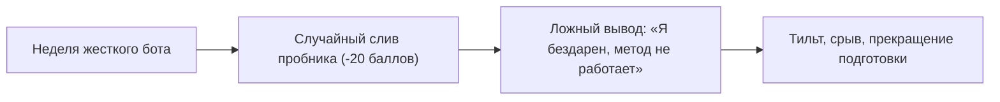

# 🎲 Конспект: Утечки энергии и закон больших чисел

> *"Самая большая трагедия человека — оценивать правильность стратегии по сиюминутному результату одной случайной раздачи. Мысли категориями математического ожидания на длинной дистанции."*  
> — **Максим Олегович Коваль**

---

## 🎯 Главная суть

Энергия человека утекает не в тяжелый интеллектуальный труд, а в **два критических бага мышления**:

1. **Фоновые открытые петли (эффект Зейгарник)**: незавершенные, подвешенные дела и обязательства жрут оперативную память мозга (RAM leak), вызывая ощущение хронической усталости еще до начала реальной работы.
2. **Тильт от локальной дисперсии**: неспособность отличить *качество решения* от *случайного исхода*. 

Устранение этих утечек достигается через **внешнюю разгрузку оперативной памяти** и переход на **вероятностное мышление (+EV)**, опирающееся на **Закон больших чисел (ЗБЧ)**.

---

## ⚠️ Анатомия проблемы (Почему 90% делают наоборот)

### 1. Катастрофа открытых петель в голове
Мозг человека эволюционно не предназначен для хранения списков дел. Когда задача не завершена и не зафиксирована во внешней надежной системе:
- Мозг постоянно генерирует фоновые микро-импульсы тревоги: *«не забудь отправить справку», «надо доделать номер 14», «надо ответить куратору»*.
- Человек садится решать сложный параметр №18 или писать код, но 40% его рабочей памяти уже занято обслуживанием открытых петель. Возникает быстрый ступор и бегство в соцсети.

### 2. Ловушка оценки по результату (Outcome Bias)
Большинство людей судят о себе по единичному событию:



Они не понимают, что в любой сложной системе присутствует **локальная дисперсия (шум)**. Бросить эффективную подготовку из-за одного неудачного варианта — то же самое, что выбросить монету с положительным мат. ожиданием после трех решек подряд.

---

## 🧠 Ключевые ментальные модели и законы

### 1. Эффект Зейгарник и протокол очистки RAM

> **Эффект Зейгарник**: психика сохраняет напряжение и удерживает внимание на незавершенных процессах значительно сильнее, чем на завершенных.

Для ликвидации утечек энергии используется 4-ступенчатый фильтр:

```
                  ┌─────────────────────────────────────────┐
                  │      Входящая открытая петля            │
                  └────────────────────┬────────────────────┘
                                       │
                         [ Занимает < 2 минут? ]
                                ├── ДА ──> Сделать немедленно (Rule of 2 min)
                                └── НЕТ ─┐
                                         │
                         [ Можно перепоручить? ]
                                ├── ДА ──> Делегировать (снять с себя)
                                └── НЕТ ─┐
                                         │
                         [ Критично для цели? ]
                                ├── НЕТ ─> Удалить / Выбросить навсегда
                                └── ДА ──> Резервный буфер (Backlog)
```

1. **Правило 2 минут**: мелкие задачи (оплатить связь, скинуть файл, подтвердить встречу) делаются моментально, не попадая в списки.
2. **Резервный буфер (Backlog)**: выгрузка задач на бумагу или в Obsidian. Как только мозг видит, что задача надежно сохранена вне головы, контур напряжения отключается.
3. **Делегирование**: передача рутинных механических задач (даже если ты студент/школьник — делегируй быт, меняйся дежурствами, автоматизируй скриптами).
4. **Анализ цены отказа**: честный ответ на вопрос *«Что реально случится в худшем случае, если я просто вычеркну это дело и никогда его не сделаю?»*. В 70% случаев последствий нет.

---

### 2. Закон больших чисел (ЗБЧ) и Математическое ожидание

В теории вероятностей (теорема Колмогорова) **Закон больших чисел** утверждает: при многократном повторении случайного эксперимента среднее арифметическое исходов сходится к истинному **математическому ожиданию**:

$$\lim_{n \to \infty} \frac{1}{n} \sum_{i=1}^n X_i = \mathbb{E}[X]$$

#### Мысленный эксперимент МО (Пари с монетой):
Представь игру: бросается монета.
- Выпадает две решки подряд — ты отдаешь **2 000 рублей**.
- В остальных случаях — ты забираешь **1 000 рублей**.
- **Математическое ожидание одной ставки**:
  $$\mathbb{E}[X] = \left(\frac{3}{4} \times 1000\right) - \left(\frac{1}{4} \times 2000\right) = 750 - 500 = +\mathbf{250\ \text{рублей}}$$

**Ситуация**: ты сделал первую ставку и проиграл 2 000 рублей. Что происходит в твоей голове?
- **Мышление 90% (дилетант)**: *«Ужас, я потерял деньги, игра грабительская, я в минусе, надо срочно отыграться или бежать!»*.
- **Мышление профессионала (+EV)**: *«Я совершил математически безупречное действие. В этой раздаче я статистически заработал +250 рублей. Локальная дисперсия против меня, но на дистанции в 1 000 бросков я неизбежно заберу сотни тысяч рублей»*.

---

### 3. Матрица жизненных решений: +EV vs -EV

| Решение | Локальный исход (1 день) | Исход на дистанции (1–2 года по ЗБЧ) | Знак EV |
| :--- | :--- | :--- | :---: |
| **Сон 8 часов + режим** | Вроде бы потерял 2 часа на учебу | Максимальный IQ, здоровая ЦНС, 100 баллов, Иннополис | **+EV** |
| **Ежедневный бот 2-й части ЕГЭ** | Сегодня устал, решил только 2 номера | Неумолимый рост математического аппарата до максимума | **+EV** |
| **Скроллинг соцсетей / Reels** | Получил легкий кайф на 40 минут | Дофаминовая яма, синдром дефицита внимания, слив вуза | **-EV** |
| **Ночной бот перед зачетом** | Зачет сдан на тройку | Убитый следующий день, провал недельного графика | **-EV** |

---

## ⚡ Системные выводы

1. **Не держи в голове ни одной задачи**: освободи RAM мозга для решения сложнейших алгоритмических и математических проблем.
2. **Перестань судить о себе по локальному результату**: плохой день или сломанный пробник — это просто белый шум дисперсии.
3. **Фарми +EV каждый божий день**: если каждый твой шаг имеет положительное математическое ожидание, Закон больших чисел математически гарантирует победу на дистанции.
4. **Хладнокровие игрока в покер**: принимай решения на основе холодного расчета мат. ожидания, а не паники или эйфории.

---

## 🔗 Связанные материалы

- Практический протокол разгрузки: [[Упражнение - Утечки энергии и закон больших чисел]]
- Цикл дофамина: [[Конспект - Пожиратели энергии и системный цикл ПДВ]]
- Биологические пики: [[Конспект - Биологические пики и защита Prime Time]]
