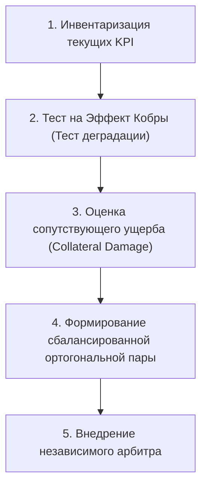

# 🛠️ Практический протокол: Аудит искажения метрик

> **«Если твой трекер привычек заполнен зелеными галочками, а реального прорыва нет — поздравляю, ты только что выкормил собственную кобру.»**

---

## 🎯 Цель практики
Выявить скрытые паразитные метрики («эффекты кобры»), которые тратят когнитивный ресурс на имитацию прогресса, и заменить их на жесткие, устойчивые к манипуляциям индикаторы реального мастерства.

---

## ⚡ Триггер к запуску протокола
- Расхождение между красивыми отчетами трекера и реальным результатом (на пробнике, на собеседовании, в кодовой базе).
- Чувство усталости и опустошенности при формальном «закрытии всех планов на день».
- Желание брать простые задачи вместо трудных ради отметки в трекере.
- Подозрение, что KPI в учебе или работе стимулируют вредное поведение.

---

## 📋 Пошаговый алгоритм



### Шаг 1: Экспликация метрики под прицелом
Выбери показатель, на который ты опираешься больше всего:
- *Примеры:* «Часы чистого времени в трекере Pomodoro», «Количество решенных задач из открытого банка», «Количество закрытых PR в GitHub», «Вес на грифе штанги».

### Шаг 2: Тест на Эффект Кобры
Задай себе 3 диагностических вопроса:
1. *Каким самым легким и нечестным путем я могу удвоить этот показатель?*
2. *Если я сделаю это, вырастет ли моя реальная способность решать трудные задачи на экзамене/в проде?*
3. *Не превратилась ли метрика в самоцель, ради которой я жертвую качеством?*

### Шаг 3: Расчет сопутствующего ущерба (Collateral Damage)
Зафиксируй, чем конкретно ты платишь за искусственную накрутку этой цифры:
- Прокрастинация сложных тем (№18 параметры, №19 теория чисел).
- Накопление скрытых пробелов в фундаментальной теории.
- Снижение способности выдерживать длительное интеллектуальное напряжение без внешних стимулов.

### Шаг 4: Построение ортогонального балансира
К каждой метрике объема ($M_{\text{объем}}$) привяжи метрику качества ($M_{\text{качество}}$), которая наказывает за дешевый читинг:
- Было: «Решить 15 задач по планиметрии».
- Стало: «Решить 15 задач, из которых минимум 5 — уровня реального ЕГЭ прошлых лет, без единого обращения к подсказке, с чистым математическим оформлением».

### Шаг 5: Назначение внешнего слепого арбитра
Метрика не должна проверяться тем же мозгом, который ее выполняет:
- Независимый экспертный пробник с проверкой строгим проверяющим / куратором.
- Автоматизированные тесты и линтеры в коде (`golangci-lint`, бенчмарки), которые нельзя отключить.

---

## 📝 Готовый шаблон аудита для Obsidian

```markdown
### 🕵️ Протокол аудита метрики: [Название метрики]
**Дата проведения:** {{date}}  
**Анализируемый показатель:** 

#### 1. Анализ уязвимости (Тест на кобру)
- Каким способом мозг имитирует рост показателя?
  - *Ответ:*
- Растет ли при этом глубинная компетенция? **(НЕТ / ДА, НО СЛАБО)**

#### 2. Инвентаризация сопутствующего ущерба
> [!CAUTION] Скрытые издержки текущей метрики:
> - [ ] Пропуск трудных концептов ради красивой статистики.
> - [ ] Ложное спокойствие перед реальным срезом.
> - [ ] Выгорание от бессмысленного механического труда.

#### 3. Переход на ортогональную пару
| Старая метрика (Объем) | Новая парная метрика (Качество) | Способ независимой верификации |
| :--- | :--- | :--- |
| [например: 4 часа за матаном] | [$\ge 3$ задачи №18 доведены до ответа] | [Сверка с эталонным решением] |

#### 4. Правило стоп-крана
Если при проверке качества показатель падает ниже 70%, объемная метрика автоматически **обнуляется**, день считается днем работы над ошибками.
```

---

## ⚠️ Типичные ошибки при аудите

1. **Замена одного суррогата на другой суррогат**: Переход от «часов за столом» к «количеству страниц конспекта». Конспект можно переписывать столь же бездумно.
2. **Отказ от метрик вообще (Анархия)**: Сказать «раз метрики врут, я буду учиться по наитию». Это приводит к мгновенному сползанию в хаос и прокрастинацию. Метрики нужны, но в виде сбалансированного тензора!
3. **Отсутствие стресс-теста во времени**: Оценка метрики только на коротком горизонте (1-2 дня), где читинг еще не успел разрушить общую базу.

---

## 🔗 Связанные материалы

- Конспект лекции: [[Конспект - Закон Гудхарта]]
- Инструмент проектирования: [[Упражнение - Проверка решений по шкале МЗС]]
- Комплексная диагностика: [[Упражнение - Комплексный фильтр когнитивных слепых зон]]
- Карта модуля: [[03_Knowledge/Мышление и Продуктивность/README|База Знаний: Мышление, Энергия и Осознанность]]
