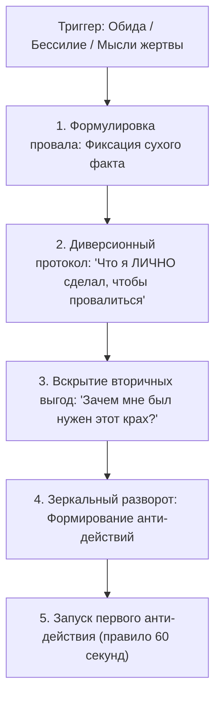

# 🛠️ Практический протокол: Возврат локуса контроля (Инверсия ответственности)

> **«Признай себя главным диверсантом собственного успеха. Выпиши список своих диверсий, ощути ледяную ярость — и разверни эту силу против лени.»**

---

## 🎯 Цель практики
Быстро и беспощадно выбить себя из пассивной позиции «жертвы обстоятельств» (режим NPC) при любом кризисе, срыве дедлайна или провале задачи, вернуть внутренний локус контроля и направить энергию раздражения на немедленное выполнение созидательных действий.

---

## ⚡ Триггер к запуску протокола
- Желание пожаловаться кому-то на жизнь, несправедливость, сложный вариант экзамена, тупые требования колледжа или преподавателей.
- Состояние апатии после проваленного пробника, контрольной или спринта: «У меня опускаются руки, мир против меня».
- Навязчивые мысли в пассивном залоге: «Мне не повезло», «Так сложились обстоятельства», «Я просто не успел».

---

## 📋 Пошаговый алгоритм



### Шаг 1: Фиксация факта без соплей
Сформулируй факт поражения или тупика одним сухим предложением без оправданий:
- *Пример:* «Я набрал 54 балла на пробнике по профилю» или «Я сорвал недельный план по написанию кода на Go».

### Шаг 2: Протокол личной диверсии
Произнеси вслух и запиши формулу:
> **«Я сделал всё необходимое, чтобы этот результат оказался именно таким. Вот полный список моих личных диверсионных действий:»**
- Выпиши минимум 4 конкретных активных действия, которыми ты разрушал свою цель:
  1. *Я умышленно залипал в Telegram до 2 часов ночи.*
  2. *Я сознательно подглядывал в ответы при решении домашней работы.*
  3. *Я намеренно не задавал вопросов куратору, боясь показаться глупым.*
  4. *Я осознанно откладывал разбор параметров на потом.*

### Шаг 3: Вскрытие скрытых выгод (Shadow Benefits)
Честно ответь на вопрос:
> *«Какую трусливую выгоду я получил от этого провала?»*
- Не надо напрягаться на максимуме;
- Можно побыть жертвой и получить сочувствие;
- Можно не сталкиваться со страхом реальной конкуренции за 100 баллов.

### Шаг 4: Зеркальный разворот (Анти-протокол)
Преврати каждую диверсию в прямое, зеркальное действие:
- Вместо «залипал до 2 ночи» $\to$ **«Телефон на полку в 22:30, экран заблокирован»**.
- Вместо «подглядывал в ответы» $\to$ **«5 задач вслепую на чистом бланке с таймером»**.
- Вместо «боялся спросить» $\to$ **«Прямо сейчас пишу куратору самый тупой вопрос»**.

### Шаг 5: Немедленный физический пуск
Выполни первое зеркальное действие **в течение первых 60 секунд** после заполнения шаблона. Пока адреналин и злость не угасли, переведи их в мышечный импульс.

---

## 📝 Готовый шаблон для Obsidian

```markdown
### 🔄 Протокол Инверсии Ответственности: [Название ситуации]
**Дата:** {{date}}  
**Факт кризиса:** 

---

#### 1. Мой личный вклад в катастрофу
> [!WARNING] Я признаю, что сделал всё возможное для провала. Вот мои диверсии:
1. Я лично: 
2. Я лично: 
3. Я лично: 
4. Я лично: 

#### 2. Вскрытие вторичных выгод слабости
- Зачем моему эго было выгодно проиграть?
  - *Ответ:* 

#### 3. Зеркальный анти-протокол
| Моя диверсия | Зеркальное действие силы | Дедлайн выполнения |
| :--- | :--- | :--- |
| [диверсия 1] | [действие 1] | [прямо сейчас] |
| [диверсия 2] | [действие 2] | [до конца дня] |

---

### ⚡ Действие прямо сейчас (Правило 60 секунд)
- [ ] Физический шаг сделан: [записать конкретное действие]
```

---

## ⚠️ Типичные ошибки практики

1. **Сползание в чувство вины и самобичевание**: Цель упражнения — не назвать себя «плохим человеком», а назвать себя **активным автором своих действий**. Чувство вины парализует; авторство дарует власть!
2. **Оставление внешних виновников**: Мысль: «Ну 80% виноват я, но 20% — всё же препод». Нет! Для твоей жизни ты берешь **100% ответственности**. Даже если упал метеорит, ты отвечаешь за свою реакцию на него.
3. **Откладывание зеркального действия**: «Я расписал шаблон, теперь отдохну, а с понедельника начну». Это слив. Если не сделал действие за 60 секунд — протокол аннулирован.

---

## 🔗 Связанные материалы

- Конспект лекции: [[Конспект - Инверсия ответственности]]
- Мгновенный импульс: [[Упражнение - Перехват управления хаосом]]
- Деконструкция катастрофы: [[Упражнение - Деконструкция худшего сценария]]
- Карта модуля: [[03_Knowledge/Мышление и Продуктивность/README|База Знаний: Мышление, Энергия и Осознанность]]
