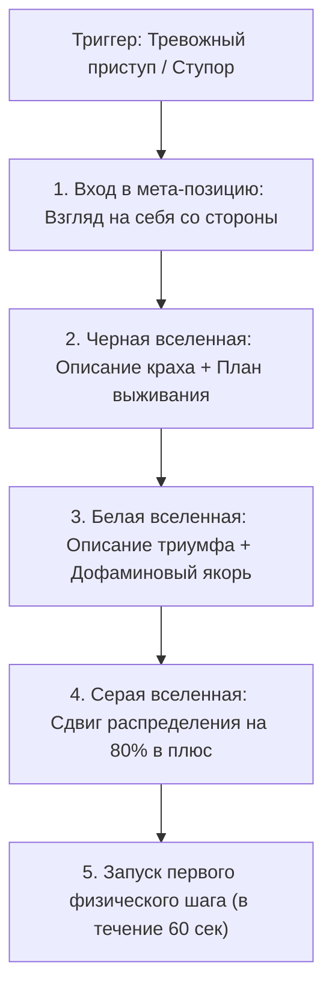

# 🛠️ Практический протокол: Деконструкция худшего сценария (Трихотомия исходов)

> **«Если страх парализует тебя — сядь за стол, включи холодного аудитора и выгрузи кошмар на бумагу. Когда чудовище заперто в клетке текста, оно теряет власть над твоим пульсом.»**

---

## 🎯 Цель практики
Ликвидировать фоновую тревогу и парализующий страх неопределенности через формализацию трех исходов Мультивселенной (Черного, Белого и Серого), высвободив до 70% заблокированного когнитивного ресурса для целенаправленных действий.

---

## ⚡ Триггер к запуску протокола
- Бессонница, навязчивые мысли по кругу: «А вдруг я завалю экзамен / диплом / собеседование / проект?».
- Ступор перед началом сложной задачи: прокрастинация матана, откладывание звонка или важного письма.
- Ощущение надвигающейся катастрофы без явной физической угрозы.
- Конфликт или разрыв в отношениях, вызывающий ощущение «рушащегося мира».

---

## 📋 Пошаговый алгоритм: Трихотомия Мультивселенной



### Шаг 1: Активация мета-позиции советника
- Сделай глубокий выдох. Скажи себе:
  > *«Я сейчас не участник драмы. Я — внешний стратег-консультант, который бесплатно спасает этого человека. Что я вижу по фактам?»*

### Шаг 2: Проектирование Чёрной вселенной (Дно колодца)
- Опиши абсолютный крах без прикрас. Что самое худшее может произойти в физической реальности?
- Задай себе 2 вопроса:
  1. *Умру ли я от этого физически? (В 99.9% случаев — НЕТ).*
  2. *Каковы мои первые 3 шага по выходу из этой точки дна?*
- Зафиксируй: из чего складывается цепочка краха? Какие 2 критические ошибки нельзя совершать ни в коем случае?

### Шаг 3: Проектирование Белой вселенной (Сияющий триумф)
- Опиши идеальный исход: максимальный балл, триумфальное поступление, физическая форма, карьерный взлет.
- Почувствуй вкус этой победы. Зафиксируй: **«Игра стоит свеч. Ради этой реальности я готов терпеть боль и дискомфорт текущего этапа»**.

### Шаг 4: Калибровка Серой вселенной (Реальный сектор)
- Реальность окажется между черным и белым.
- Сформулируй 3 конкретных защитных действия, которые сдвинут вероятность на 80% в сторону Белой вселенной.

### Шаг 5: Перехват управления (Мгновенное действие)
- В течение 60 секунд после завершения протокола сделай одно микро-физическое действие, направленное к Белой вселенной (открыть конспект, решить одну задачу, выйти на пробежку).

---

## 📝 Готовый шаблон для Obsidian

```markdown
### 🌌 Мультивселенная исходов: [Формулировка страха / ситуации]
**Дата аудита:** {{date}}  
**Истинный источник тревоги:** 

---

#### 🖤 1. ЧЁРНАЯ ВСЕЛЕННАЯ (Худший сценарий / Фиаско)
- **Что произошло в худшем случае:** 
- **Мои первые 3 шага по ликвидации последствий:**
  1. 
  2. 
  3. 
> [!NOTE] Урок Черной вселенной:
> Цепочка ошибок, которую категорически запрещено допустить: ...

---

#### 🤍 2. БЕЛАЯ ВСЕЛЕННАЯ (Триумфальный образ будущего)
- **Что произошло в лучшем случае:** 
- **Главный эмоциональный приз (Ради чего игра?):** 
> [!TIP] Запрос на энергию:
> Мозг видит награду. Игра стоит свеч на 100%.

---

#### 🩶 3. СЕРАЯ ВСЕЛЕННАЯ (Реалистичное смещение на 80%)
- **Где ляжет реальное математическое ожидание:** 
- **3 действия, гарантирующие смещение чаши весов в плюс:**
  - [ ] 1. 
  - [ ] 2. 
  - [ ] 3. 

---

### ⚡ Немедленное микро-действие (В течение 60 секунд)
- [ ] Сделано прямо сейчас: 
```

---

## ⚠️ Типичные ошибки практики

1. **Недожатый худший сценарий**: Бояться дописать черную вселенную до конца. Если ты остановился на полуслове, амигдала продолжит пугать тебя недосказанным. Дойди до самого дна!
2. **Пропуск белой вселенной**: Погрузиться в стоический негатив и остаться там. Без белой вселенной у ЦНС нет дофамина для действий.
3. **Остаться в теории**: Заполнить красивую табличку и продолжить лежать на диване. Завершение протокола ОБЯЗАНО сопровождаться физическим действием в течение минуты!

---

## 🔗 Связанные материалы

- Конспект лекции: [[Конспект - Как победить страх (Создай мультивселенную)]]
- Перехват импульса: [[Упражнение - Перехват управления хаосом]]
- Авторская позиция: [[Упражнение - Возврат локуса контроля]]
- Карта модуля: [[03_Knowledge/Мышление и Продуктивность/README|База Знаний: Мышление, Энергия и Осознанность]]
