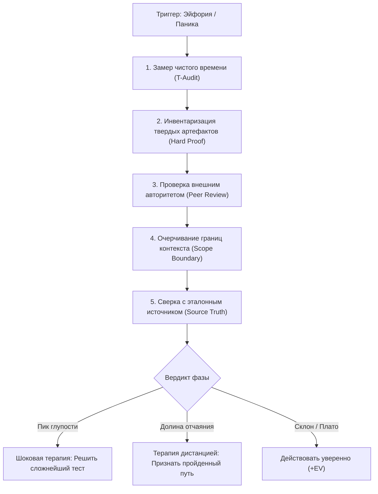

# 🛠️ Практический протокол: Калибровка реальной компетенции (Голый король)

> **«Прежде чем сделать судьбоносный ход, проверь, не одет ли ты в невидимое платье короля. Пять минут честного аудита уберегут от года расхлебывания последствий.»**

---

## 🎯 Цель практики
Точно локализовать свое положение на кривой Даннинга-Крюгера перед принятием ответственных решений (выбор стратегии подготовки, запуск проекта, распределение ресурсов) и сбалансировать уровень уверенности с реальным багажом навыков.

---

## ⚡ Триггер к запуску протокола
- Ощущение легкой эйфории: «Всё понятно, задача элементарная, здесь не о чем думать!».
- Желание кардинально изменить утвержденный учебный или тренировочный план, пропустив «слишком простые» базовые блоки.
- Острая просадка самооценки (состояние в Долине Отчаяния: «Я бездарность, ничего не получается, все зря»).
- Подготовка к публичному выступлению, собеседованию или написанию экзамена.

---

## 📋 Пошаговый алгоритм (5 столпов «Голого короля»)



### Шаг 1: Аудит времени (T-Audit)
- Зафиксируй строгое число месяцев и часов, посвященных глубокому, осознанному изучению темы.
- *Правило МО:* Если стаж $< 100$ часов, уровень уверенности $> 80\%$ является клиническим признаком Пика Глупости.

### Шаг 2: Эксгумация твердых доказательств (Hard Proof)
- Что ты можешь предъявить в качестве физического артефакта?
- Оценки в школе не считаются. Считаются: решенные вслепую варианты прошлых лет, задеплоенный и протестированный код, победы в турнирах.

### Шаг 3: Внешний слепой срез (Peer Review)
- Задай вопрос независимому эксперту (куратору, преподавателю, старшему инженеру):
  > *«Я считаю, что готов сдавать эту тему на 100%. Вот моя работа. Разорви её в клочья и покажи слабые места».*

### Шаг 4: Делимитация контекста (Scope Boundary)
- В каких смежных областях ты абсолютно не разбираешься?
- Где заканчивается применимость твоего локального успеха? (Например: решение уравнений с параметром методом $Oxa$ не означает понимание геометрии параметров).

### Шаг 5: Сверка с первоисточником
- Открой кодификатор ФИПИ, спецификацию экзамена или фундаментальный учебник.
- Проверь, сколько терминов из кодификатора вызывают у тебя ступор.

---

## 📝 Готовый шаблон для Obsidian

```markdown
### 👑 Чек-лист калибровки: [Название дисциплины / Задачи]
**Дата:** {{date}}  
**Текущая субъективная уверенность (1–10):** 

#### 1. Пять столпов проверки
- [ ] **1. Чистый стаж:** [____ часов осознанной практики]
- [ ] **2. Твердый результат:** [доказанный срез / баллы на независимом тесте: _____]
- [ ] **3. Внешняя валидация:** [мнение куратора / ментора: _____]
- [ ] **4. Границы контекста:** [где моя компетентность заканчивается: _____]
- [ ] **5. Сверка с эталоном:** [проверено по официальной спецификации / учебнику: (ДА/НЕТ)]

#### 2. Диагностика положения на кривой
- [ ] **Пик глупости** (Мало опыта + Зашкаливающая уверенность)
  - *Действие:* Найти 3 сложнейшие задачи из реальных вариантов прошлых лет и решить под таймером.
- [ ] **Долина отчаяния** (Много опыта + Ощущение беспомощности)
  - *Действие:* Напомнить себе, что падение уверенности обусловлено масштабом кругозора. Зафиксировать прогресс относительно точки «6 месяцев назад».
- [ ] **Склон просветления / Плато** (Сбалансированное хладнокровие)
  - *Действие:* Спокойно продолжать реализацию плана.

#### 3. Итоговая корректировка уверенности
- Скорректированная рабочая уверенность: [___ / 10]
- Корректирующее действие дня: 
```

---

## ⚠️ Типичные ошибки и самообман

1. **Принятие школьных пятерок за экспертность**: Школьная программа часто оторвана от уровня олимпиад и профильного ЕГЭ на 100 баллов.
2. **Обида на критику эксперта**: Когда старший наставник показывает ошибку в логике, незрелый ум включает защиту: «Он ко мне придирается». Зрелый ум радуется: «Отлично, найдена дыра в защите, я ликвидирую её до боя».
3. **Застревание в Долине Отчаяния**: Поверить внутреннему критику и бросить занятия. Долина Отчаяния — это самый продуктивный этап, именно здесь происходит реальное обучение!

---

## 🔗 Связанные материалы

- Конспект лекции: [[Конспект - Голый король (Контра Даннинга-Крюгера)]]
- Анализ чужого опыта: [[Упражнение - Моделирование дерева альтернативных исходов]]
- Комплексный скрининг: [[Упражнение - Комплексный фильтр когнитивных слепых зон]]
- Карта модуля: [[03_Knowledge/Мышление и Продуктивность/README|База Знаний: Мышление, Энергия и Осознанность]]
