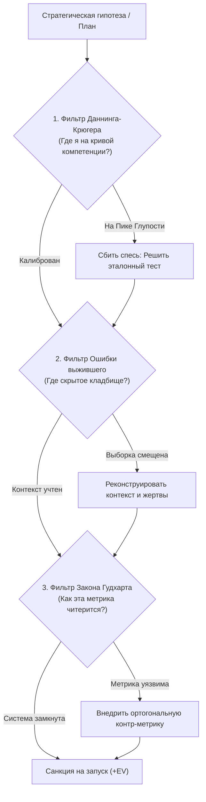

# 🛠️ Практический протокол: Комплексный фильтр когнитивных слепых зон

> **«Прежде чем поставить на кон свои ресурсы, прогони решение через тройное сито: убей в себе наглого дилетанта, раскопай кладбище неудачников и сломай свои фальшивые счетчики.»**

---

## 🎯 Цель практики
Провести экспресс-диагностику стратегического плана, методики подготовки или бизнес-гипотезы через триумвират ментальных моделей (Даннинг-Крюгер, Ошибка выжившего, Закон Гудхарта) до того, как отрицательное математическое ожидание ($EV < 0$) уничтожит ресурсы.

---

## ⚡ Триггер к запуску протокола
- Внезапная непреодолимая уверенность: «Я нашел легкий и гениальный способ заботать матан/поднять деньги/войти в IT, до которого никто не додумался!».
- Желание скопировать красивую историю успеха из социальных сетей или медиа.
- Принятие решений с высокой ценой ошибки (выбор стратегии подготовки к ЕГЭ, смена стека технологий, крупные финансовые вложения).
- Систематический застой результатов при идеальных внутренних отчетах.

---

## 📋 Пошаговый алгоритм: Тройной фильтр



### Фаза 1: Срез Даннинга-Крюгера (Калибровка смирения)
1. Сколько времени суммарно я непрерывно занимаюсь этой предметной областью?
2. Получал ли я независимую оценку от признанного эксперта или официального среза (без снисхождения)?
3. Если уверенность 9/10 или 10/10 при стаже менее года — ты на **Пике Глупости**.
   - *Действие:* Немедленно пройти самый сложный официальный вариант прошлых лет без подглядываний.

### Фаза 2: Срез Ошибки выжившего (Эксгумация фактов)
1. Кто является моим источником вдохновения? Не смотрю ли я на единственный триумфальный выброс?
2. Каковы были исходные ресурсы у выжившего (деньги семьи, годы олимпиадной базы, уникальная генетика, закрытый нетворкинг)?
3. Какова реальная статистика исходов: сколько людей предприняли аналогичные действия и провалились?
   - *Действие:* Найти 3 детальные истории провала по этой же стратегии и выписать их критические ошибки.

### Фаза 3: Срез Закона Гудхарта (Стресс-тест контроля)
1. Какой ключевой цифрой я буду отслеживать прогресс?
2. Можно ли увеличить эту цифру на 50%, применив хитрость, лень или читинг?
3. Какая парная метрика качества гарантирует, что рост показателя отражает реальное мастерство?
   - *Действие:* Ввести жесткое правило отбраковки результатов при нарушении стандартов чистоты.

---

## 📝 Готовый шаблон для аудита решения

```markdown
### 🛡️ Скрининг когнитивных слепых зон: [Название гипотезы]
**Дата:** {{date}}  
**Формулировка плана:** 

---

#### 1. Диагностика Даннинга-Крюгера
- [ ] Оценка субъективной уверенности: [от 1 до 10]
- [ ] Время глубокого погружения в тему: [в часах / месяцах]
- [ ] Внешнее независимое подтверждение компетенции: [Есть / Нет (где получить?)]
- **Вердикт фазы 1:** [Пик глупости / Долина отчаяния / Реальная опора]

#### 2. Диагностика Ошибки выжившего
- [ ] Исходные ориентиры (чьему примеру следую?): 
- [ ] Скрытый контекст «выжившего» (что осталось за кадром?): 
- [ ] Оценка размера «кладбища неудачников» (каков реальный шанс краха?): 
- **Вердикт фазы 2:** [Чистая авантюра / Просчитанный риск с положительным EV]

#### 3. Диагностика Закона Гудхарта
- [ ] Главная метрика прогресса: 
- [ ] Лазейка для самообмана: 
- [ ] Парная метрика контроля качества (Контр-Гудхарт): 
- **Вердикт фазы 3:** [Метрика уязвима / Контур защищен]

---

### 🏁 Финальное решение
- **Статус гипотезы:** [ОТКЛОНЕНО / НА ДОРАБОТКУ / ОДОБРЕНО К ИСПОЛНЕНИЮ]
- **Критическая контр-мера:** 
```

---

## ⚠️ Типичные ошибки при заполнении

1. **Рационализация вместо честности**: Подгонка ответов под желаемое решение («Ну со мной-то такого не случится, я же особенный»).
2. **Формальный пропуск Фазы 2**: Лень искать реальную статистику и истории провалов. Помни: кладбище молчит, пока ты сам его не раскопаешь.
3. **Отсутствие физического стресс-теста**: Ограничиться ментальными рассуждениями вместо того, чтобы сесть и прорешать сложный тест вслепую.

---

## 🔗 Связанные материалы

- Конспект триумвирата: [[Конспект - Закон Гудхарта, Ошибка выжившего и Даннинг-Крюгер]]
- Углубленные практики:
  - [[Упражнение - Калибровка реальной компетенции]]
  - [[Упражнение - Моделирование дерева альтернативных исходов]]
  - [[Упражнение - Аудит искажения метрик]]
- Карта модуля: [[03_Knowledge/Мышление и Продуктивность/README|База Знаний: Мышление, Энергия и Осознанность]]
