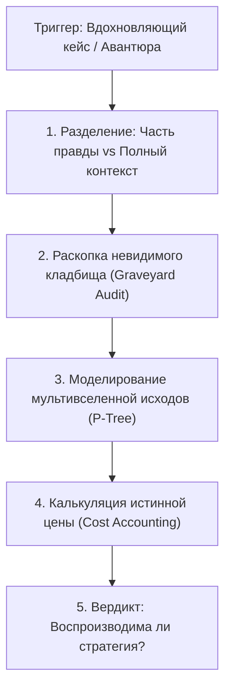

# 🛠️ Практический протокол: Моделирование дерева альтернативных исходов

> **«Не верь одной победной ветке реальности. Смоделируй всю крону дерева, загляни под корни, где лежат кости проигравших, и только тогда принимай решение.»**

---

## 🎯 Цель практики
Научиться хладнокровно препарировать вдохновляющие истории успеха, медийные кейсы и собственные смелые идеи, отделяя случайную дисперсию от устойчивого фундамента, чтобы принимать математически обоснованные решения с положительным математическим ожиданием ($+EV$).

---

## ⚡ Триггер к запуску протокола
- Желание скопировать радикальную стратегию после просмотра видео / чтения статьи («Чел за 2 недели до ЕГЭ заботал геометрию на сотку, я сделаю так же»).
- Возникновение импульса совершить рискованное действие со «ставкой ва-банк» (вложить все сбережения, забросить колледж/школу ради одного предмета).
- Появление циничного раздражения: «Все врут, успех невозможен без блата и связей».

---

## 📋 Пошаговый алгоритм



### Шаг 1: Таблица «Часть правды vs Вся правда»
- Выпиши витринный тезис: что конкретно сказано в ролике или заголовке?
- Проведи фактчекинг: найди полные интервью, подкасты, биографические данные. Что было до этого момента? Какой запас прочности имелся?

### Шаг 2: Аудит «Кладбища исходов» (Graveyard Audit)
- Представь выборку из 1 000 человек с твоим текущим бэкграундом, которые поступили точно так же.
- Сколько из них достигли того же триумфа? Сколько оказались в долговой яме или с нулевым баллом?

### Шаг 3: Моделирование ветвей мультивселенной
Построй дерево из 3 сценариев:
1. **Ветка A (Триумф выжившего)**: Что должно совпасть? Какова вероятность ($p_A$)?
2. **Ветка B (Средний исход)**: Что произойдет при нормальном распределении ($p_B$)?
3. **Ветка C (Крах)**: Каковы последствия фатального сценария ($p_C$)? Есть ли защита от разорения?

### Шаг 4: Аудит истинной цены (Cost Accounting)
- Какую цену заплатил «выживший»? (Здоровье, сон, отношения, 5 лет черновой работы).
- Готов ли ты заплатить эту цену без гарантии выигрыша?

---

## 📝 Готовый шаблон для Obsidian

```markdown
### 🌌 Деконструкция кейса: [Название истории / Идеи]
**Дата анализа:** {{date}}  
**Источник:** [ссылка / видео / идея]

---

#### 1. Анатомия информации
| Параметр | Витринная версия (Часть правды) | Реальный бэкграунд (Вся правда) |
| :--- | :--- | :--- |
| **Действие** | [например: бросил все, учил 2 недели] | [сильная база с 7 класса, физмат-школа] |
| **Подушка безопасности** | [не упоминается] | [репетиторы, финансовый тыл семьи] |
| **Масштаб риска** | [выглядит как ва-банк] | [просчитанный шаг внутри системы] |

#### 2. Инспекция скрытого кладбища
- Каков процент аналогичных попыток заканчивается катастрофой? [____ %]
- Главная причина гибели «невыживших»: 

#### 3. Ветви Мультивселенной для МОЕЙ ситуации
- [ ] **Ветка 1 (Сверх-успех):** Вероятность ~____% // Исход: 
- [ ] **Ветка 2 (Медианный исход):** Вероятность ~____% // Исход: 
- [ ] **Ветка 3 (Тотальный крах):** Вероятность ~____% // Исход: 

#### 4. Калькулятор цены
- Чем придется заплатить на дистанции: 
- Имею ли я право рисковать этим ресурсом? **(ДА / НЕТ)**

---

### ⚖️ Итоговый вывод
- **Природа результата выжившего:** [Слепая дисперсия / Твердый закономерный базис]
- **Решение:** [КОПИРОВАТЬ НЕЛЬЗЯ / ВЗЯТЬ ТОЛЬКО ИНСТРУМЕНТ X, ДОБАВИВ БАЗУ Y]
```

---

## ⚠️ Типичные ошибки анализа

1. **Позиция страуса**: Нежелание искать информацию о провалах из страха разрушить красивую мотивационную сказку.
2. **Игнорирование принципа невосполнимости**: Ставить на кон невосполнимые ресурсы (здоровье, психику, базовое образование) ради иллюзорного мгновенного куша.
3. **Путаница между смелостью и глупостью**: Настоящая смелость — делать ставки с положительным мат. ожиданием при наличии рисков. Делать ставки с отрицательным мат. ожиданием — обыкновенная глупость.

---

## 🔗 Связанные материалы

- Теоретический конспект: [[Конспект - Мультивселенная исходов (Контра ошибки выжившего)]]
- Математика вероятностей: [[Упражнение - Проектирование плюсовых математических ставок]]
- Калибровка эго: [[Упражнение - Калибровка реальной компетенции]]
- Карта модуля: [[03_Knowledge/Мышление и Продуктивность/README|База Знаний: Мышление, Энергия и Осознанность]]
