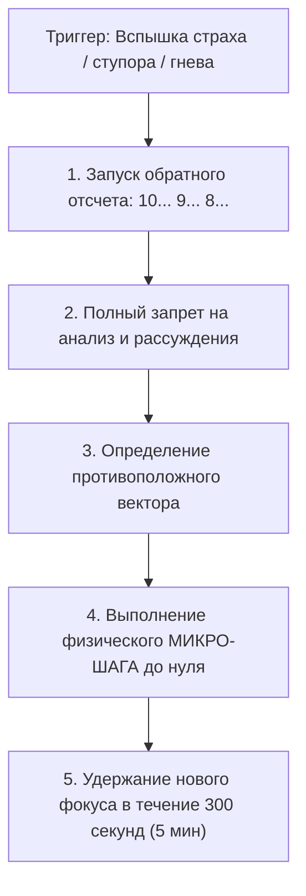

# 🛠️ Практический протокол: Перехват управления хаосом (Возглавь безумие)

> **«Пришел страх — в течение 10 секунд сделай шаг навстречу. Не давай мозгу времени придумать трусливое алиби. В любой непонятной ситуации — бомби!»**

---

## 🎯 Цель практики
Внедрить автоматический рефлекс мгновенной конвертации негативного эмоционального аффекта (страх неудачи, паника дедлайна, паралич неопределенности, вспышка гнева) в целенаправленное созидательное действие в течение критического 10-секундного окна.

---

## ⚡ Триггер к запуску протокола
- Острая вспышка страха: «Я ничего не успею, меня отчислят, я завалю ЕГЭ».
- Импульс захлопнуть ноутбук и уйти залипать в соцсети/игры от тревоги.
- Начало острой перепалки или конфликта с близким человеком.
- Утренний или дневной паралич прокрастинации (тело не хочет вставать с дивана).

---

## 📋 Пошаговый алгоритм: 10-секундный перехват



### Шаг 1: Запуск секундомера перехвата (Countdown 10)
- Как только почувствовал укол страха или желание бросить задачу — мысленно начни обратный отсчет:  
  **«10, 9, 8... Я включаю протокол перехвата»**.

### Шаг 2: Мораторий на мышление
- Категорически запрети себе взвешивать за и против. Твой мозг в этот момент находится под влиянием амигдалы и будет генерировать 100% фальшивые отговорки.

### Шаг 3: Зеркальный вектор (Противоположный полюс)
Задай один вопрос:
> *«Куда хочет сбежать мой автопилот? Что является точным противоположным действием?»*
- Хочет лечь в кровать $\to$ Вскочить и сделать 15 приседаний.
- Хочет закрыть сборник задач $\to$ Ткнуть пальцем в первую попавшуюся задачу и прочитать условие вслух.
- Хочет наорать в ответ в конфликте $\to$ Сказать: «Я спокоен, давай помолчим 60 секунд».

### Шаг 4: Выполнение микро-шага (До счета «ноль»)
- До того, как счет дойдет до нуля, твое тело должно совершить физическое перемещение в пространстве в сторону противоположного вектора.

### Шаг 5: 300-секундный замок (Lock-In)
- После совершения микро-шага удерживай фокус на задаче ровно 5 минут. По истечении 5 минут биохимический выброс амигдалы распадется, включится префронтальная кора, и ты войдешь в рабочий поток.

---

## 📝 Готовый шаблон трекинга перехватов для Obsidian

```markdown
### 🌪️ Журнал перехвата хаоса: [Эпизод / День]
**Дата и время:** {{date}} {{time}}  
**Входящий аффект (Страх / Ступор / Ярость):** 

#### 1. Диагностика импульса
- Куда тянул животный автопилот: 
- Противоположное действие силы: 

#### 2. Фиксация 10-секундного удара
- [ ] Отсчет 10-9-8 запущен.
- [ ] Рассуждения отключены.
- [ ] Физический микро-шаг сделан до истечения таймера: [что конкретно сделано?]

#### 3. Статус после 5 минут удержания
- [ ] Уровень тревоги / ступора упал с 10 до: [____ / 10]
- [ ] Состояние: [В рабочем потоке / Требуется повторный перехват]
```

---

## ⚠️ Типичные ошибки практики

1. **Попытка спланировать всё до конца**: В 10-секундном окне нельзя пытаться расписать план на месяц. Нужен только **первый физический шаг** (взять ручку, открыть IDE, сделать 10 отжиманий).
2. **Переговоры с мозгом**: Попытка убедить себя: «Ну я сейчас 5 минуток полистаю рилсы и начну». Если ты начал переговоры — ты проиграл.
3. **Недооценка силы противоположного шага в конфликтах**: Считать, что спокойствие в ссоре — это унижение. Настоящий альпинист знает: тот, кто первым гасит хаос, управляет всей связкой.

---

## 🔗 Связанные материалы

- Конспект лекции: [[Конспект - Возглавь безумие]]
- Авторская позиция: [[Упражнение - Возврат локуса контроля]]
- Деконструкция страха: [[Упражнение - Деконструкция худшего сценария]]
- Карта модуля: [[03_Knowledge/Мышление и Продуктивность/README|База Знаний: Мышление, Энергия и Осознанность]]
