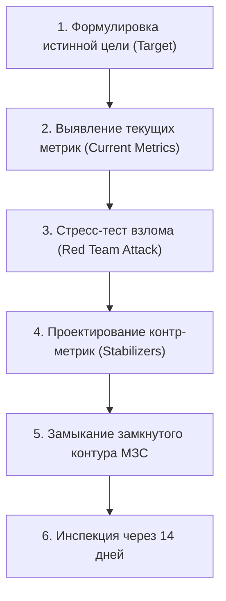

# 🛠️ Практический протокол: Проверка решений по шкале МЗС

> **«Если твою систему метрик может взломать школьник с ленью восьмого уровня, ты меряешь не прогресс, а собственное спокойствие.»**

---

## 🎯 Цель практики
Спроектировать и протестировать на взломоустойчивость персональную систему метрик (МЗС) для любой ключевой сферы (подготовка к ЕГЭ на 300 баллов, изучение Go/Linux, тренировки в зале), исключив проявление Закона Гудхарта и самосаботаж.

---

## ⚡ Триггер к запуску протокола
- Ощущение, что «я целыми днями пашу, а баллы на пробниках/результаты в коде стоят на месте».
- Появление соблазна подсмотреть решение в решебнике или опереться на готовый ответ нейросети.
- Старт нового учебного или рабочего спринта (настройка системы координат).
- Раз в 14 дней в ходе регулярного аудита личной эффективности.

---

## 📋 Пошаговый алгоритм



### Шаг 1: Формулировка целевого вектора
Зафиксируй конкретную боевую цель без абстракций:
- *Пример:* «100 баллов по профильной математике на ЕГЭ» или «Написание распределенного сервиса на Go с тестами и покрытием >80%».

### Шаг 2: Экспликация текущих метрик
Выпиши всё, чем ты сейчас измеряешь свой прогресс. Сколько часов сидишь? Сколько задач решил? Сколько страниц прочел?

### Шаг 3: Атака «Красной команды» (Red Team Attack)
Встань в позицию циничного внешнего аудитора или ленивого саботажника. Задай вопрос:
> *«Каким образом я могу довести эти показатели до идеала (10/10), не приблизившись к цели ни на миллиметр?»*
- *Пример взлома:* Буду смотреть вебинары фоном под чай, задачи брать только из банка первой части, формулы держать на стикере перед монитором, а пробники писать без таймера, заглядывая в критерии проверки.

### Шаг 4: Инъекция стабилизирующих контр-метрик
На каждую лазейку добавь ортогональный показатель-контролер:
- Лазейка «Подглядывание в формулы» $\to$ **Контр-метрика**: Процент ДЗ, решенный в слепом режиме с первого захода.
- Лазейка «Бесконечный просмотр теории» $\to$ **Контр-метрика**: Коэффициент Active Recall (минут самостоятельного штурма / минут просмотра вебинара $\ge 1.5$).
- Лазейка «Высиживание времени» $\to$ **Контр-метрика**: Число качественно разобранных и занесенных в банк ошибок задач второй части.

### Шаг 5: Проверка на минимальную достаточность (Zero Friction)
Убедись, что итоговых метрик не более 3–4. Избыток метрик порождает бюрократический паралич.

---

## 📝 Готовый шаблон для вставки в заметку / спринт

```markdown
### 📐 Аудит МЗС: [Название цели / Сфера]
**Дата:** {{date}}  
**Истинная цель:** 

#### 1. Действующие метрики
- Метрика 1: 
- Метрика 2: 

#### 2. Взлом системы (Как мозг читерит эти метрики)
> [!WARNING] Векторы уязвимости:
> 1. ...
> 2. ...

#### 3. Обновленный контур МЗС (Векторная стабилизация)
- [ ] **M1 (Объем):** [например, 12 задач 2-й части в неделю]
- [ ] **M2 (Глубина):** [процент решений без единой подсказки $\ge 80\%$]
- [ ] **M3 (Стресс-контроль):** [1 слепой пробник в боевом тайминге раз в 2 недели]
- [ ] **M4 (Работа над дефектами):** [100% разбор ошибок из пробника в течение 48 часов]

#### 4. Вердикт взломоустойчивости
- Можно ли выполнить все 4 пункта и остаться нулем? **(ДА / НЕТ)**
- Если ДА — какая контр-мера закрывает дыру?
```

---

## ⚠️ Типичные ошибки и самосаботаж

1. **Создание 15 метрик (Бюрократический ад)**: Попытка трекать пульс, влажность воздуха, минуты, секунды. Ты превращаешься в бухгалтера, а не инженера. Оставь 3–4 жесткие метрики.
2. **Мягкие условия верификации**: Писать пробник дома, позволяя себе отвлекаться на чай, Telegram или музыку. Верификация должна быть максимально жестокой — как на реальном экзамене.
3. **Игнорирование фактора памяти**: Отсутствие в системе метрики повторного возврата к старым ошибкам. Забывание — неизбежный физиологический процесс.

---

## 🔗 Связанные материалы

- Теоретический базис: [[Конспект - Метрика здравого смысла (МЗС)]]
- Следующий уровень: [[Упражнение - Аудит искажения метрик]]
- Карта модуля: [[03_Knowledge/Мышление и Продуктивность/README|База Знаний: Мышление, Энергия и Осознанность]]
